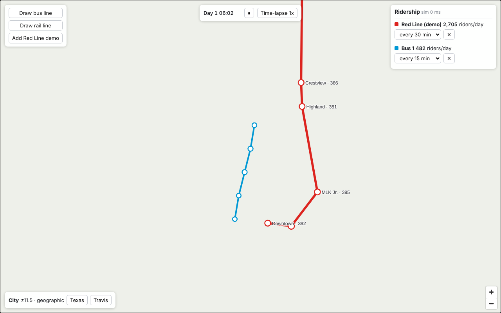
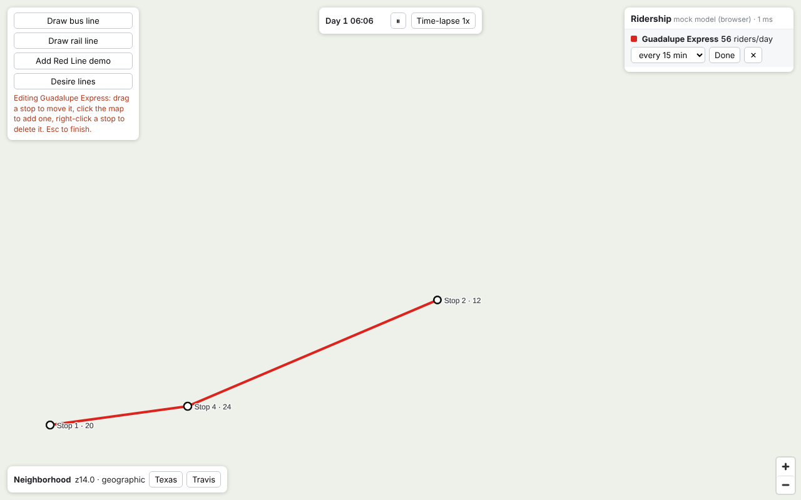
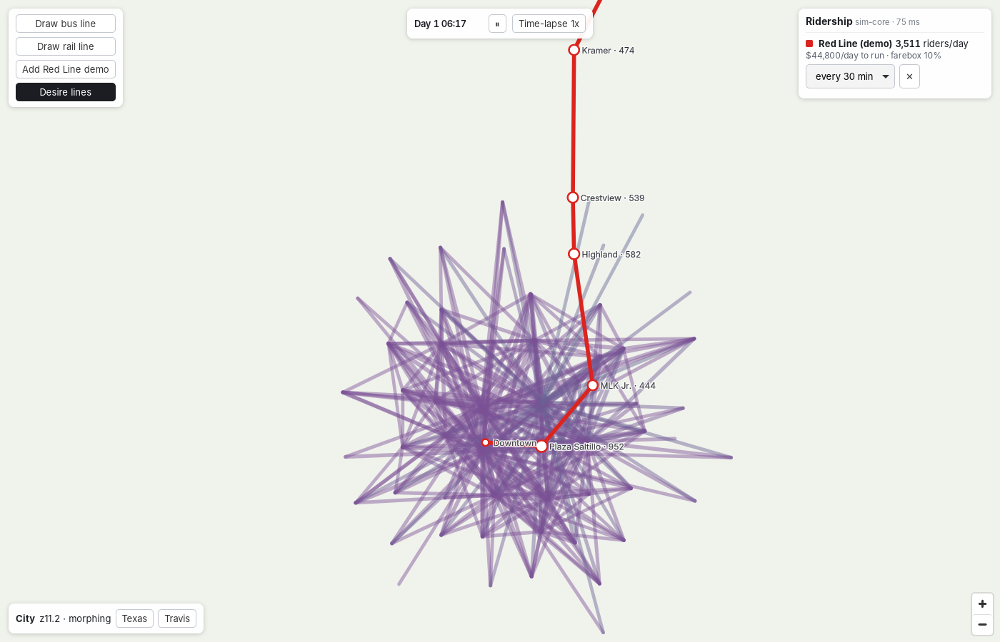

# Transpo-Sim app

The desktop game client: a [Tauri 2](https://tauri.app) shell (`src-tauri/`, Rust) that links
[`sim-core`](../crates/sim-core/README.md) as native code, around a map client in the webview
(Vite + TypeScript + [MapLibre GL](https://maplibre.org), `src/`). It delivers the app side of
roadmap features F05 (shell and map), F15 (Tauri command interface to the `Sim` API), F16 (line
drawing), F17 (ridership readout), F21 (one clock with time-lapse, client-side prototype) and
F41/F42 (tube-style schematic and its zoom morph). Scope today is the Travis County test bench for
M0/M1. The app holds no simulation logic: the numbers come from sim-core in the desktop app, or
from a TypeScript mock when the client runs in a plain browser.







## Run

Prerequisites: Node 20+, npm, Rust stable, and the
[Tauri system dependencies](https://tauri.app/start/prerequisites/). On Debian/Ubuntu that is
`libwebkit2gtk-4.1-dev libgtk-3-dev librsvg2-dev libsoup-3.0-dev`.

```bash
cd app
npm ci              # exact versions from package-lock.json
npm run tauri dev   # desktop app with the real sim-core (first Rust build takes a few minutes)
npm run dev         # browser only at http://localhost:1420, mock sim, no Rust needed
```

| Command | What it does |
|---|---|
| `npm run tauri dev` | Desktop app with hot reload. Builds `src-tauri` and starts the Vite server on port 1420 (fixed; Tauri expects it) |
| `npm run tauri build` | Installable desktop bundle |
| `npm run dev` | Browser client against `MockSim` |
| `npm run build` | Type-check (`tsc --noEmit`) then production build into `dist/` |
| `TRANSPO_SCENARIO=path/to/scenario.json npm run tauri dev` | Load a real `ScenarioInput` (data-pipeline output) instead of the synthetic region |

On startup, sim-core builds the scenario on a background thread. That takes about 4 s for the
synthetic Travis-sized region in `tauri dev`, where sim-core is optimized even in dev builds
(decision A16), and about 2 s in a release build. sim-core reports about 15 s (release) on the
real Travis road graph (93k nodes). The window opens right away, the ridership panel header shows
`sim-core · loading…` until `sim_status` reports ready, and a line drawn before then waits for
the build. The terminal prints
`[sim] ready in N ms` or `[sim] failed to start: ...`.

### Controls

- **Draw bus line / Draw rail line**: click the map to drop stops. **Enter** or double-click
  finishes, **Esc** cancels. Clicking an existing stop snaps to it, so lines can share an
  interchange.
- **Edit stops** (per line, in the ridership panel): zooms to the line and draws it in true
  geography. Drag a stop to move it, click the map to add a stop (it goes where it lengthens the
  line least), and right-click a stop to delete it (a line keeps at least two). Dragging an
  interchange stop moves the other lines' stop with it, so the interchange stays connected. **Esc** or
  **Done** finishes. Each finished edit re-runs the sim; drags preview without a sim call until
  you release.
- **Rename a line**: double-click its name in the panel, type, then **Enter** (or click away).
  **Esc** cancels.
- **Desire lines**: toggles the top 300 zone pairs by daily trips (F06). Width scales with the
  square root of trips relative to the busiest pair. Color runs from purple (no transit) to green
  (10%+ transit share). It refreshes after every line edit, so you can watch transit share move.
- **Add Red Line demo**: an approximate CapMetro Red Line (9 stations, commuter rail, 30-min
  headway).
- **Ridership panel** (top right): weekday boardings per line. With sim-core it also shows
  operating cost per day and farebox recovery. The header shows which backend answered and the
  round-trip time of the last call (M1 target: under 2 s). Changing the headway dropdown re-runs
  the sim.
- **Clock** (top center): pause with the button or **Space**. Space is ignored while a button or
  dropdown has focus, so it never toggles twice. **Time-lapse** (or **T**) cycles 1x, 2x, 10x and
  60x. At 1x, one real second is one game minute.
- **Zoom badge** (bottom left): the current zoom band (State, Region, City, Neighborhood), whether
  lines are drawn schematic or geographic, and jump buttons for Texas and Travis County.

Bus lines only appear from City zoom (z11) in. That follows the design doc: local routes stay
geographic and only show from City zoom down.

## Test

```bash
cd app && npm ci && npm run build && npm test && (cd src-tauri && cargo fmt --check && cargo test --locked && cargo clippy --locked --all-targets -- -D warnings)
```

- `npm test` (Vitest, [test/core.test.ts](test/core.test.ts)): clock arithmetic and zoom
  independence; schematic invariants (octilinear elbows, one point per stop, interchange merging);
  mock-sim sanity (Red Line ridership in a plausible band and rising with frequency); the Tauri
  adapter mapping `RouteSpec` to `TransitLine` and per-stop results back by stop id. No fixtures.
- `cargo test` in `src-tauri` ([src/sim.rs](src-tauri/src/sim.rs)): the add, update and remove
  round trip through the command layer against `synth::SynthConfig::small()`, including that the
  same client id updates in place, and that a failed scenario load returns an error instead of
  hanging. It runs in about 0.1 s.
- The root `cargo test --workspace` does **not** cover `app/`, because `src-tauri` is its own
  workspace.
- CI: [.github/workflows/app.yml](../.github/workflows/app.yml) runs on PRs that touch `app/`,
  `crates/sim-core/` or the workflow. The `web` job runs `npm ci`, `npm run build` and `npm test`.
  The `tauri` job installs the WebKitGTK and GTK dev packages, then runs `cargo fmt --check`, `cargo test --locked` and
  `cargo clippy --locked --all-targets -- -D warnings` in `src-tauri`.

## Interfaces

### Client to simulation: `SimClient` ([src/sim/api.ts](src/sim/api.ts))

```ts
interface SimClient {
  readonly label: string;                                // shown in the ridership panel
  ready(): Promise<void>;                                // resolves when the backend is built
  desireLines(n: number): Promise<DesireLine[]>;         // top n zone pairs by daily trips
  upsertRoute(route: RouteSpec): Promise<RouteResult[]>; // add or replace; results for EVERY route
  removeRoute(id: string): Promise<RouteResult[]>;
}
```

- `RouteSpec`: `id` (client string, `r1`, `r2`, ...), `name`, `mode`, `color`, `stops[]`
  (`id`, `name`, `lngLat` as WGS84 `[lon, lat]` in degrees), `headwayMin` (minutes), `fare`
  (USD per boarding).
- `Mode` uses sim-core's `TransitLine` mode strings exactly (`bus` ... `ferry`; no hyperloop).
  `isRegional(mode)` is false for `bus`, `trolleybus` and `brt`, and true for everything else. It
  decides schematic versus geographic drawing.
- `RouteResult`: `routeId`, `dailyRiders` (weekday boardings, rounded), `boardingsByStop` (keyed by
  stop id), plus optional `operatingCostPerDay` (USD) and `fareboxRecovery` (fare revenue over
  operating cost). The mock leaves the optional fields out.

`createSim()` ([src/sim/index.ts](src/sim/index.ts)) returns `TauriSim` when
`"__TAURI_INTERNALS__" in window`, and `MockSim` otherwise.

### Tauri commands ([src-tauri/src/sim.rs](src-tauri/src/sim.rs))

| Command | Args (JSON, camelCase from JS) | Returns |
|---|---|---|
| `upsert_route` | `routeId: string`, `line: TransitLine` | `RouteResultOut[]` for every client route |
| `remove_route` | `routeId: string` | `RouteResultOut[]` |
| `desire_lines` | `n: number` | Top `n` zone pairs by daily trips: `{ from: [lon,lat], to: [lon,lat], trips, transit_trips }[]`, largest first |
| `sim_status` | none | `{ ready, error, source }`; `source` is the scenario path or `"synthetic"` |

`RouteResultOut` is sim-core's `LineResult` with `route_id` (the client id) flattened into it.
`boardings_by_stop` is aligned with the line's stops. The shell keeps the map from client
route id to sim-core `LineId`, so the webview never sees `LineId`s and never holds simulation
state. Errors come back as rejected promises with sim-core's readable message.

`TransitLine` conversion ([src/sim/tauri.ts](src/sim/tauri.ts) `toTransitLine`): `lngLat` becomes
`lon`/`lat`, and `headwayMin` becomes `headway_min`. `park_ride` is true on every stop of a
regional line and false for local lines. Speed, span and per-km fare are left to sim-core's mode
defaults.

### Scenario input

The `TRANSPO_SCENARIO` environment variable points to a `ScenarioInput` JSON file
([schema](../crates/sim-core/README.md#input-schema-contract-with-data-pipeline)). Without it the
shell uses `sim_core::synth::generate(&SynthConfig::default())`, a Travis-sized synthetic region
(676 zones, 1.3M people) centered on downtown Austin.

## Design and rationale

The full rationale is in [docs/DECISIONS.md](docs/DECISIONS.md) (A1 to A13). In short:

- **Two backends behind one interface.** The real sim runs in Rust, but `npm run dev` should still
  work in a browser with no Rust toolchain. The mock covers that, and also keeps the UI testable
  in CI.
- **Upserts return every line's results.** Lines compete for riders in sim-core, so one edit can
  move every line's numbers.
- **Sim built off the main thread; commands are async.** `Sim::new` takes seconds. Async Tauri
  commands run on the async runtime's worker threads, so waiting for the build never freezes the
  window.
- **The client still owns the clock.** sim-core's `tick()` re-equilibrates at day boundaries,
  which takes seconds and needs a worker loop. That lands with F21's move into sim-core. Until
  then, line edits refresh results directly.
- **Schematic computed in the client.** It is a pure function of the line geometry and zoom
  ([docs/SCHEMATIC.md](docs/SCHEMATIC.md)), not simulation state.
- **`src-tauri` is its own Cargo workspace** (empty `[workspace]` table). The root workspace
  (`members = ["crates/*"]`) belongs to sim-core, and sim-core is consumed as a path dependency.

More: [docs/ARCHITECTURE.md](docs/ARCHITECTURE.md) (modules, data flow, map layers, clock).

## Known gaps

| Gap | Fixed by |
|---|---|
| Lines are straight from stop to stop, not snapped to roads | Road graph from the pipeline plus a router (F16 follow-up) |
| Desire lines are straight zone-to-zone chords capped at 300 pairs; no filtering by purpose or mode | F06 follow-up if playtests want it |
| No capital cost preview while drawing or editing; operating cost shows after commit | F23 (sim-core capital cost model), then F16 |
| Mode picker is two buttons (bus, light rail); fare fixed at $1.25 | F16 |
| `park_ride` is all-or-nothing per line | Per-stop properties in the stop editor (F16) |
| Clock is client-side; `Sim::tick` is not called, so car congestion only updates at sim build | F21 |
| Schematic is greedy: parallel lines can overlap, no station pins | F41 |
| Basemap tiles come from OpenFreeMap over the network; CSP is off | Bundled tiles (F33), then tighten CSP |
| Mock numbers are uncalibrated outside the Red Line point ([docs/MOCK-SIM.md](docs/MOCK-SIM.md)) | Browser-only; the desktop app uses sim-core |
| Placeholder icons | F46 |

## Status

| Feature | Status in `app/` |
|---|---|
| F05 Tauri shell and map | Done: shell, map and sim-core linked |
| F15 Tauri command interface | Done (app side): `upsert_route`, `remove_route`, `sim_status`. Clock advance not wired |
| F16 Line drawing | Partial: draw, edit stops (move, insert, delete), rename, headway, delete line. Missing: capital cost preview (needs sim-core's cost model, F23) and mode/fare pickers |
| F17 Ridership readout | Done for line totals and per-stop boardings, plus cost and farebox from sim-core |
| F21 Clock and time-lapse | Prototype: client clock at 1/2/10/60x, no skip-to-month |
| F41 / F42 Schematic and morph | Prototype: heuristic layout, no pins |
| F06 Desire lines | Done (app): layer from `Sim::desire_lines`; the M0 exit check (F07) is the pipeline's |

## Layout

```
app/
├── index.html            HUD markup (panels, buttons)
├── src/
│   ├── main.ts           App wiring: state, rendering, UI events, clock loop
│   ├── map.ts            MapLibre setup, basemap + offline fallback, all layers, zoom bands
│   ├── draw.ts           Click-to-place line drawing tool
│   ├── geo.ts            km(): distance helper shared by the editor, schematic and mock
│   ├── edit.ts           Stop editor: drag, insert (least added length), delete; bestInsertIndex()
│   ├── schematic.ts      Tube-map layout + geo/schematic morph
│   ├── clock.ts          Game clock and time-lapse
│   ├── style.css         HUD styling
│   ├── data/geo.ts       Texas/Travis outlines, bounds, Red Line preset
│   └── sim/
│       ├── api.ts        SimClient interface + shared types (the contract)
│       ├── tauri.ts      TauriSim: sim-core through Tauri commands
│       ├── mock.ts       MockSim: browser-only stand-in model
│       ├── queue.ts      serialQueue(): sim calls run one at a time, in order
│       └── index.ts      createSim(): picks the backend
├── test/core.test.ts     Vitest unit tests
├── src-tauri/
│   ├── src/main.rs       Tauri builder: state + command registration
│   ├── src/sim.rs        Sim lifecycle, client-id to LineId map, commands, tests
│   └── Cargo.toml        Own [workspace]; sim-core by path
└── docs/                 ARCHITECTURE, SCHEMATIC, MOCK-SIM, DECISIONS, ROADMAP-APP
```
