# Transpo-Sim app

The desktop game client: a [Tauri 2](https://tauri.app) shell (`src-tauri/`, Rust) that links
[`sim-core`](../crates/sim-core/README.md) as native code, around a map client in the webview
(Vite + TypeScript + [MapLibre GL](https://maplibre.org), `src/`). It delivers the app side of
roadmap features F05 (shell and map), F15 (Tauri command interface to the `Sim` API), F16 (line
drawing), F17 (ridership readout), F21 (one clock with time-lapse, client-side prototype) and
F41/F42 (tube-style schematic and its zoom morph). Scope today is the Travis County test bench for
M0/M1. The app holds no simulation logic: the numbers come from sim-core in the desktop app, or
from a TypeScript mock when the client runs in a plain browser.

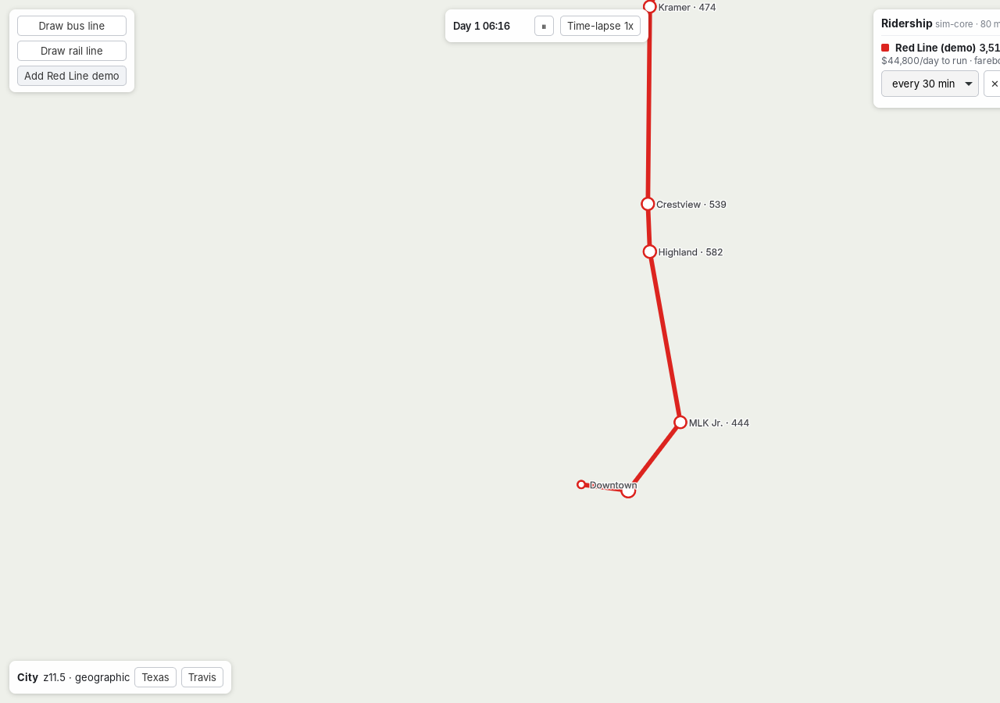

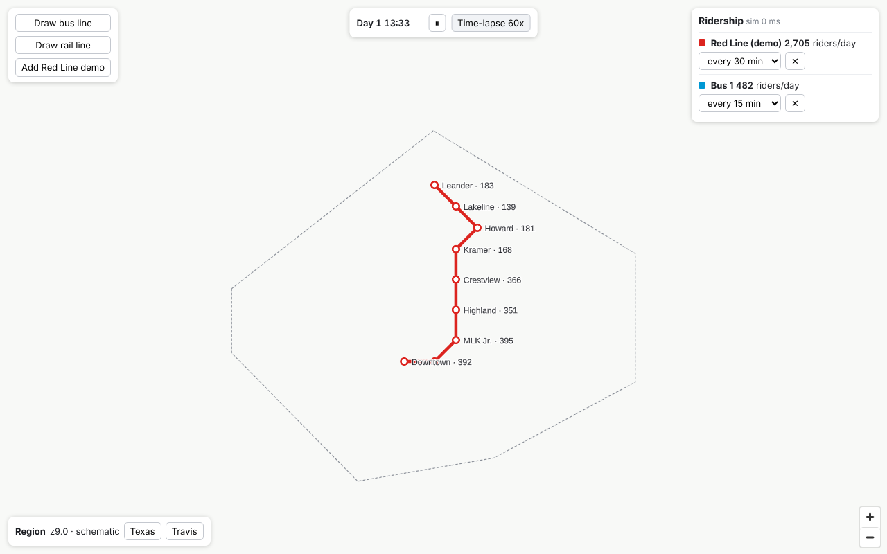

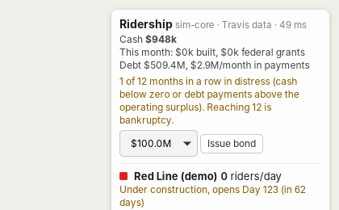
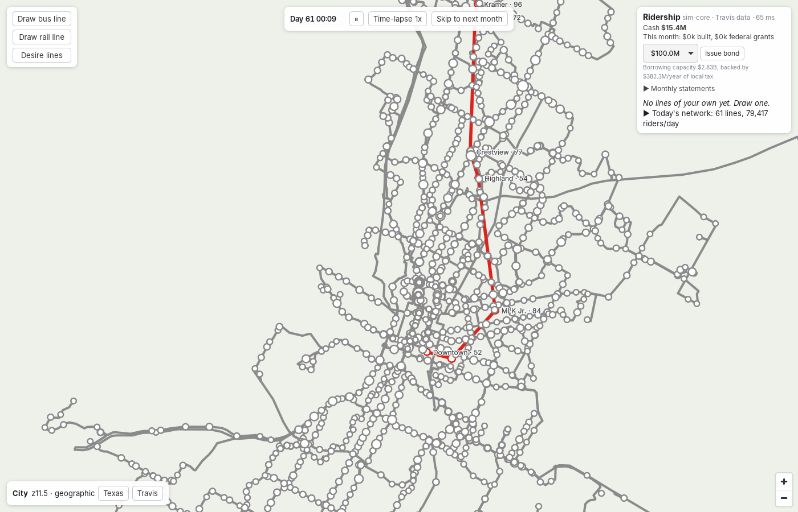
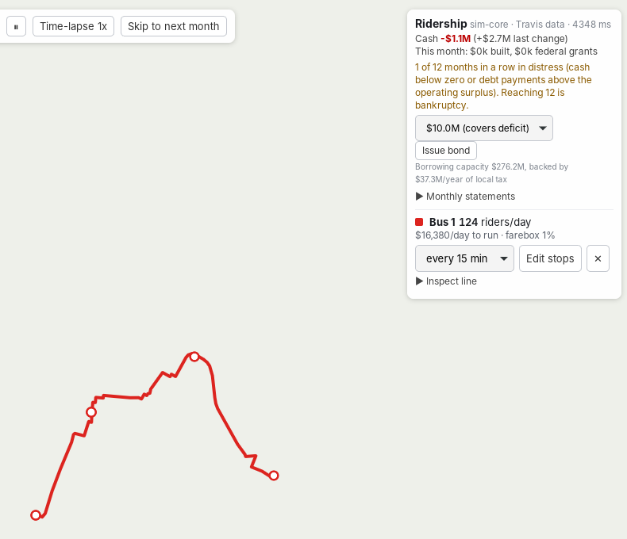
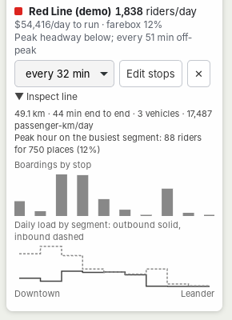
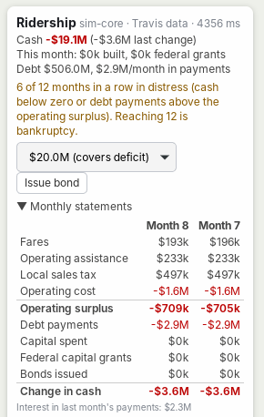
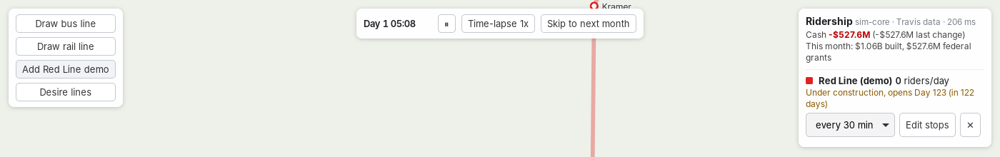
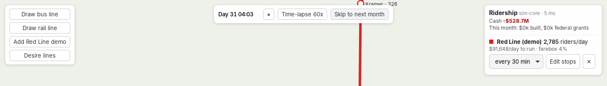
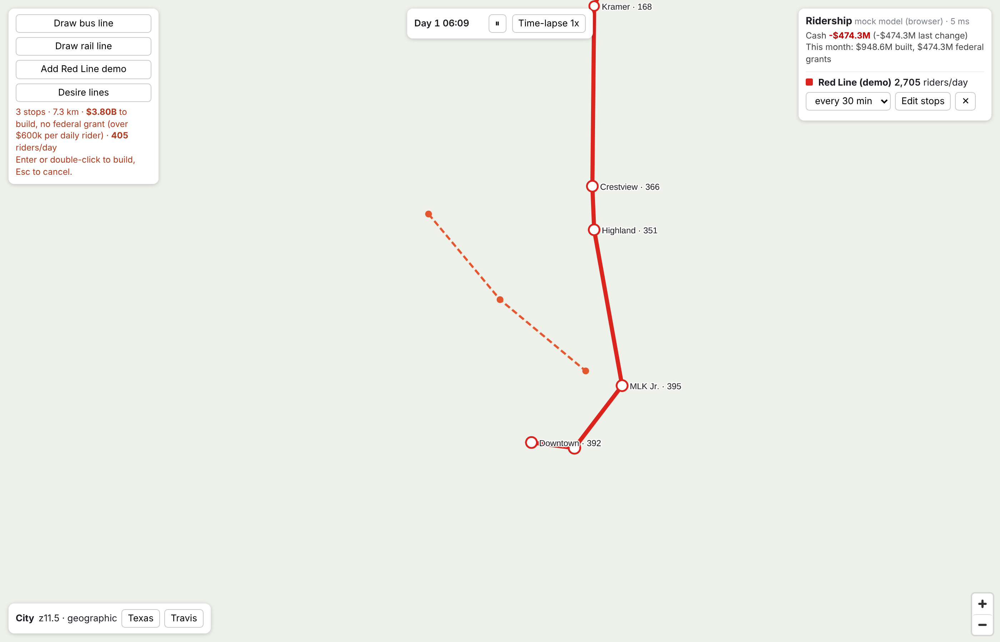


## Run

Prerequisites: Node 20+, npm, Rust stable, and the
[Tauri system dependencies](https://tauri.app/start/prerequisites/). On Debian/Ubuntu that is
`libwebkit2gtk-4.1-dev libgtk-3-dev librsvg2-dev libsoup-3.0-dev`.

```bash
cd app
npm ci              # exact versions from package-lock.json
npm run data        # once: download the real Travis County build (11 MB) from GitHub Releases
npm run tauri dev   # desktop app with the real sim-core (first Rust build takes a few minutes)
npm run dev         # browser only at http://localhost:1420, mock sim, no Rust needed
```

| Command | What it does |
|---|---|
| `npm run tauri dev` | Desktop app with hot reload. Builds `src-tauri` and starts the Vite server on port 1420 (fixed; Tauri expects it) |
| `npm run tauri build` | Installable desktop bundle |
| `npm run dev` | Browser client against `MockSim` |
| `npm run build` | Type-check (`tsc --noEmit`) then production build into `dist/` |
| `npm run data:texas` | Download the statewide build (release `data-48-2023-tract-highway`, 47 MB, 6,896 tracts, highway roads) into `crates/data-pipeline/data/out/48-2023-tract-highway/` |
| `npm run data` | Download the data pipeline's published Travis build (release `data-48453-2023`) into `crates/data-pipeline/data/out/48453-2023/` (gitignored). Runs the pipeline's `scripts/download-build.sh` |
| `TRANSPO_SCENARIO=path/to/scenario.json npm run tauri dev` | Load any `ScenarioInput` file (another pipeline build) instead of the default |

**Which scenario loads** (first match wins, decision A24):

1. `TRANSPO_SCENARIO`, if set. A missing file is an error, since you asked for it.
2. The real Travis County build at `crates/data-pipeline/data/out/48453-2023/scenario.json`, if
   `npm run data` has downloaded it.
3. sim-core's synthetic Travis-sized region.

The panel header names the source: `sim-core · Travis data` or `sim-core · synthetic region`.

**Starting network** (F44, decision APP-4): the game starts with today's CapMetro network,
which the data pipeline writes to `existing_lines.json` beside `scenario.json` (DATA-7: 61
lines, GTFS weekday headways). If the scenario itself carries `lines`, those are used instead.
`TRANSPO_EXISTING_NETWORK=0` (or `off`, `false`) starts on a blank map. On by default as an
interim call while Collins decides the starting state; it balances since sim-core SIM-12 (see
"Scenario input" below for the figures). The lines are open from day 1 and already paid for.
They appear grouped under **Today's network** in the panel (collapsed: line count and total
riders; rail first, then busiest first), the Red Line in red and buses in gray, named
"Route 801" from their route number. They can be edited, inspected or deleted like your own.
**Add Red Line demo** is hidden when the Red Line is already running. A build without
`existing_lines.json` starts blank.

On startup, sim-core builds the scenario on a background thread. Measured in `tauri dev` (sim-core
optimized even in dev builds, decision A16): about 11 s on the real Travis build (766 zones,
93k-node road graph) and about 4 s on the synthetic region. sim-core reports about 7 s on real
Travis in a release build. The window opens right away, the ridership panel header shows
`sim-core · Travis data · loading…` until `sim_status` reports ready, and a line drawn before
then waits for the build. The terminal prints
`[sim] ready in N ms` or `[sim] failed to start: ...`.

### Statewide Texas (F34, decisions A32 to A34)

```bash
npm run data:texas
TRANSPO_SCENARIO=$PWD/../crates/data-pipeline/data/out/48-2023-tract-highway/scenario.json npm run tauri dev
```

- **Tier.** A scenario with more than 2,000 zones runs on sim-core's strategic tier (A32):
  zone pairs within 60 free-flow car minutes, 8 cold assignment rounds (sim-core's settings after
  SIM-15). Travis keeps the dense model. The panel header says `sim-core · Texas data`.
- **Loading screen.** Startup is over a minute statewide, so a card shows the stage (reading the
  scenario, then the first traffic equilibrium for 6,896 census tracts), a bar and the seconds
  elapsed and left against an estimate (200 s cold, 70 s warm, as measured below). The bar stops at 97% and the text says when it
  is taking longer than the estimate. sim-core has no progress callback, so the bar is time
  against the estimate, not work done. A county build shows no card.
- **Warm start** (SIM-19, A36). After a cold start the shell saves the starting road volumes
  (`Sim::road_state`, 3.5 MB) as `road_state-network.json` (or `road_state-blank.json` on a
  blank map) beside the scenario. The next start reads it and calls `Sim::new_warm`, so the first
  equilibrium is one warm day: 230 s cold, 72 s warm with 455 lines (measured below). It is never
  overwritten during play, so every warm start begins from the same roads. A state from another
  road graph (sim-core's fingerprint) or from another build of the data (size and time of
  `scenario.json` and `existing_lines.json`, so a republish on the same roads counts) is ignored
  and the start is cold. Delete the file, or
  set `TRANSPO_WARM_START=0`, to start cold; a cold start saves a fresh one. The card says
  "Settling traffic from the last start's roads" when warm. The Travis build saves and reads one
  too.
- **Opens on all of Texas.** Once the scenario is read, the map fits the zone extent.
- **Real regional rail and intercity lines** (A33). The pipeline's `transit.json` holds every
  OSM transit route in Texas. The shell keeps rail, light rail and tram, one variant per line
  (the one with most stops), and leaves out CapMetro's (they run in sim-core as today's network).
  That is 18 lines. Since DATA-9 (#77) the statewide `existing_lines.json` runs DART, METRORail,
  TRE, TEXRail, the A-train and the Dallas and McKinney Avenue streetcars as real service, so
  the client drops a reference line when more than half its stops are within 300 m of a running
  rail stop (`notRunning`). Five remain: Amtrak Texas Eagle, Sunset Limited and Heartland Flyer,
  the El Paso Streetcar and the Grapevine Vintage Railroad. They are drawn in the tube view with
  their own colors and listed under **Other real rail** in the panel. They are drawn only:
  sim-core does not run them, so they carry no riders and cost nothing.
- **Today's network statewide** (DATA-9): 415 lines from every agency's GTFS (CapMetro, DART,
  Houston METRO, Trinity Metro, DCTA, VIA, CCRTA, El Paso), 14 of them rail. Rail takes its
  color from the GTFS name (`existingColor`: "BLUE LINE" is blue, TRE, TEXRail and the A-train
  their own); buses are gray.
- **New day computing** (SIM-18). The clock worker calls `Sim::tick_budgeted(dt, 100 ms)`, so
  a day's re-run runs in slices with the lock released in between and the clock keeps going.
  The clock panel shows `New day computing 43%` (`day_progress`) until it ends; results and
  car times are the previous day's until then, and the client re-reads results when it ends.
  A command waiting for the lock goes before the next slice.

  
- **County detail** (A34). From City zoom in, the zoom badge names the county under the map
  center (`City z11.5 · geographic · Travis County`), from the nearest tract's GEOID in
  `zones.json`. Zooming in is a view change only: the strategic tier still scores the whole
  state, because the camera never changes the score. A county's own detailed model (block
  groups, every street) is sim-core's local tier (F28, F35), not built.

Measured 2026-11-27 in `tauri dev` under Xvfb on 4 cores (WebKit's software rendering takes
about 1.3 cores, so a desktop with a GPU should be faster), with the DATA-9 build (415 lines at
start): ready in 201 to 214 s (230 s cold and 72 s warm with the republished 455-line build); a day's re-run takes about 45 s of wall time in slices; adding a
2-stop bus line takes about 16 s for the whole round trip (preview, upsert, results, budget)
with or without a day computing, and removing one about 2 s. The add cost grows with the
number of lines (4.5 s with 61 lines before sim-core SIM-17); reported to sim-core. Today's
network carries about 409,000 riders/day on the statewide tier (tract zones, highway roads
only): a strategic-tier figure, not a calibration result. sim-core's `examples/statewide.rs`
took 77 s cold and 20.5 s a day on the same machine (release, no lines).

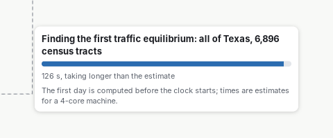
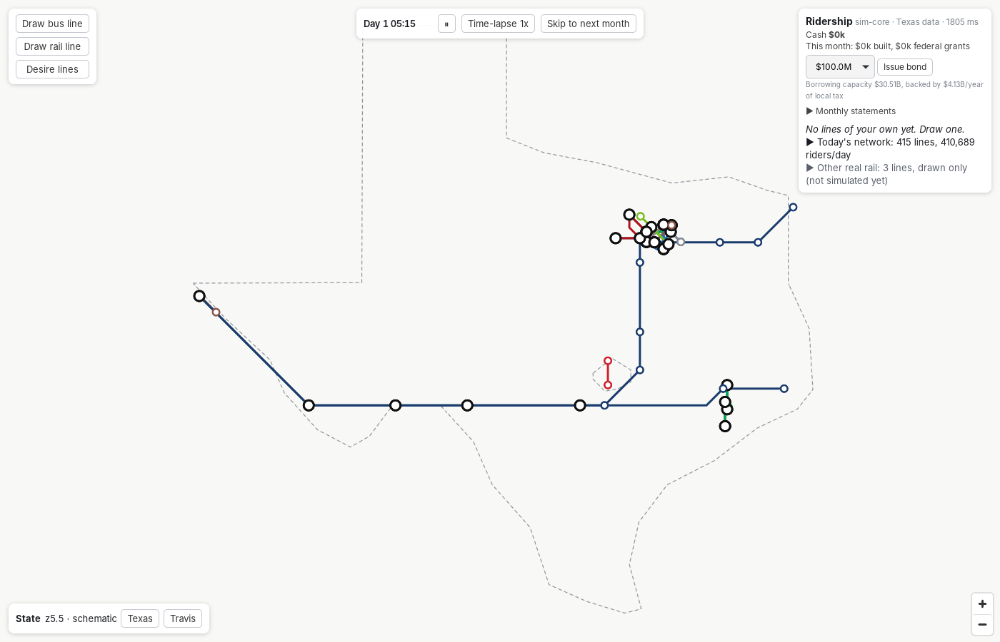
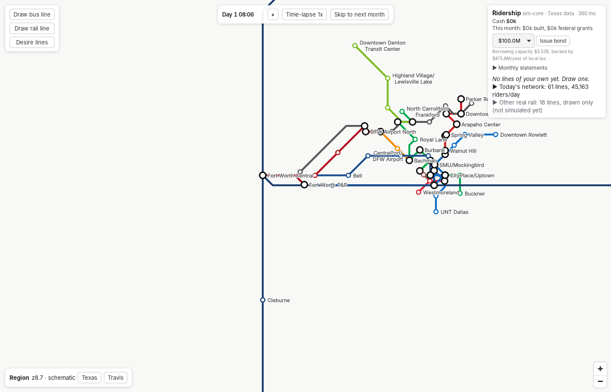

### Controls

- **Draw bus line / Draw rail line**: click the map to drop stops. **Enter** or double-click
  finishes, **Esc** cancels. Clicking an existing stop snaps to it, so lines can share an
  interchange. From the second stop on, the hint box shows a **build cost preview**: length,
  capital cost, the federal grant it would win (or why not), forecast riders per day and daily
  operating cost. Nothing is charged until you finish the line. Bus lines follow the streets
  (sim-core routes bus, trolleybus and BRT on the road graph, SIM-8): the draft redraws along the
  roads after each stop and the hint adds the length by road, which is what sim-core charges and
  times. A stop more than 500 m from a road gets a straight segment. If the capital after the grant
  is more than cash plus borrowing capacity, the hint says so in red (building is still allowed;
  the new line's stops add tax that backs more borrowing).
- **Edit stops** (per line, in the ridership panel): zooms to the line and draws it in true
  geography. Drag a stop to move it, click the map to add a stop (it goes where it lengthens the
  line least), and right-click a stop to delete it (a line keeps at least two). Dragging an
  interchange stop moves the other lines' stop with it, so the interchange stays connected. **Esc** or
  **Done** finishes. Each finished edit re-runs the sim; drags preview without a sim call until
  you release.
- **Inspect line** (per line, under its buttons, sim-core only): route length, one-way run time,
  vehicles needed, passenger-km per day, and the busiest segment's peak-hour riders against the
  places the headway provides (red with a hint above 100%). Two charts: daily boardings at each
  stop, and the daily load on each segment in both directions (outbound solid, inbound dashed).
  Hover a bar or segment for its numbers. Hidden while a line is under construction or rebuilding,
  because sim-core's per-stop figures follow the running version's stops then (F17).
- **Rename a line**: double-click its name in the panel, type, then **Enter** (or click away).
  **Esc** cancels.
- **Desire lines**: toggles the top 300 zone pairs by daily trips (F06). Width scales with the
  square root of trips relative to the busiest pair. Color runs from purple (no transit) to green
  (10%+ transit share). It refreshes after every line edit, so you can watch transit share move.
- **Add Red Line demo**: the CapMetro Red Line's 10 real stations (OSM route 550 from the
  pipeline's Travis build, including McKalla), commuter rail, MetroRail's real service: every
  32 min in the peaks and 51 min off-peak, $3.50 fare. Picking a headway from the menu sets one
  all-day headway (the off-peak value is dropped).
- **Budget** (top of the ridership panel): cash on hand, the change from the last edit, and this
  month's capital spend and federal grants. Building charges capital less any grant; extending a
  line charges only the added cost; shrinking or deleting refunds nothing (sim-core rules, F26).
  Cash starts at $0, so the first line puts it below zero.
- **Monthly statements** (F26, under the budget, click to open): the last two closed months side
  by side, newest first. Rows: fares, operating assistance, local sales tax, operating cost,
  operating surplus, debt payments, capital spent, federal capital grants, bonds issued, change in
  cash; the interest part of the last month's payments, and any interest added to debt during
  construction, show below. Fares, operating cost and tax
  are booked only when a month ends, so the table is empty until the first one closes. It stays
  open across the daily refresh.
- **Bonds and bankruptcy** (F26, in the budget panel): pick an amount (the first option covers the
  current deficit, rounded up to $10M, or is all you can borrow if that is less) and **Issue
  bond**. Sizes above the **borrowing capacity** are not offered. Capacity is what the local tax
  around the stops of open and planned lines can back (sim-core SIM-7/SIM-9), shown under the
  button; with no lines it is 0 and the panel says to draw a line first. Cash arrives at once; monthly payments
  (30-year level payment at 5.43%, the rates in the button tooltip) start next month. The panel
  shows debt and monthly payments. A month that ends with cash below zero, or with debt payments
  above the operating surplus (fares + operating assistance + local tax - operating cost), is
  distressed; the panel counts them ("3 of 12 months in a row in distress"). Twelve in a row is
  bankruptcy: a red banner says the game is over, the bond button disappears, and the sim keeps
  running so you can see why. A bond issued while a line is under construction pays nothing until
  construction ends: its interest is added to the debt instead (capitalized interest, SIM-9), so a
  month ending with cash below zero is what counts while you build. Borrow enough to stay above
  zero.
- **Construction** (F24): a new line is paid for when you draw it but opens only after its
  mode's build time divided by 12 (light rail about 6 months, so about 183 game days; the Red
  Line demo, commuter rail, about 122). Until then the panel says "Under construction, opens Day
  N (in X days)", the line draws faded on the map and carries no riders. The drawing hint shows
  the opening day before you commit. Moving, adding or deleting stops on an open line is a
  rebuild: the old version keeps running and the panel shows when the new one opens (per-stop
  numbers are hidden until then, since the running stops differ from the drawn ones). Headway
  changes apply at once. Use **Skip to next month** or time-lapse to get there.
- **Ridership panel** (top right): weekday boardings per line. With sim-core it also shows
  operating cost per day and farebox recovery. The header shows which backend answered and the
  round-trip time of the last call (M1 target: under 2 s). Changing the headway dropdown re-runs
  the sim.
- **Clock** (top center): pause with the button or **Space**. Space is ignored while a button or
  dropdown has focus, so it never toggles twice. **Time-lapse** (or **T**) cycles 1x, 2x, 10x and
  60x. At 1x, one real second is one game minute. **Skip to next month** jumps to the first day
  of next month and settles the budget. The simulation owns the clock (F21): sim-core starts at
  Day 1 05:00 (day 0 inside sim-core), re-runs the day at each midnight (ridership refreshes in
  the panel) and settles the budget each 30-day month.
- **Zoom badge** (bottom left): the current zoom band (State, Region, City, Neighborhood), whether
  lines are drawn schematic or geographic, and jump buttons for Texas and Travis County.

Bus lines only appear from City zoom (z11) in. That follows the design doc: local routes stay
geographic and only show from City zoom down.

## Test

```bash
cd app && npm ci && npm run build && npm test && (cd src-tauri && cargo fmt --check && cargo test --locked && cargo clippy --locked --all-targets -- -D warnings)
```

- `npm test` (Vitest, [test/core.test.ts](test/core.test.ts)): clock arithmetic and zoom
  independence; schematic invariants (octilinear elbows, one point per stop, interchange merging);
  mock-sim sanity (Red Line ridership in a plausible band and rising with frequency); the Tauri
  adapter mapping `RouteSpec` to `TransitLine` and per-stop results back by stop id. No fixtures.
- `cargo test` in `src-tauri` ([src/sim.rs](src-tauri/src/sim.rs)): the add, update and remove
  round trip through the command layer against `synth::SynthConfig::small()`, including that the
  same client id updates in place, and that a failed scenario load returns an error instead of
  hanging. It runs in about 0.1 s.
- The root `cargo test --workspace` does **not** cover `app/`, because `src-tauri` is its own
  workspace.
- CI: [.github/workflows/app.yml](../.github/workflows/app.yml) runs on PRs that touch `app/`,
  `crates/sim-core/` or the workflow. The `web` job runs `npm ci`, `npm run build` and `npm test`.
  The `tauri` job installs the WebKitGTK and GTK dev packages, then runs `cargo fmt --check`, `cargo test --locked` and
  `cargo clippy --locked --all-targets -- -D warnings` in `src-tauri`.

## Interfaces

### Client to simulation: `SimClient` ([src/sim/api.ts](src/sim/api.ts))

```ts
interface SimClient {
  readonly label: string;                                // shown in the ridership panel
  ready(onProgress?): Promise<void>;                     // resolves when built; onProgress gets LoadProgress
  desireLines(n: number): Promise<DesireLine[]>;         // top n zone pairs by daily trips
  upsertRoute(route: RouteSpec): Promise<RouteResult[]>; // add or replace; results for EVERY route
  removeRoute(id: string): Promise<RouteResult[]>;
  previewRoute(route: RouteSpec): Promise<RoutePreview>; // cost + forecast, nothing charged
  budget(): Promise<Budget>;                             // cash, month, debt, distress, bankruptcy
  issueBond(principal: number): Promise<Budget>;         // borrow; rejects once bankrupt
  existingRoutes(): Promise<RouteSpec[]>;                 // lines present at start (F44)
  referenceLines(): Promise<RouteSpec[]>;                // real rail sim-core does not run; drawn only
  zoneCounties(): Promise<[lon, lat, fips][]>;           // zone centroids with county FIPS
  results(): Promise<RouteResult[]>;                     // re-read after the daily re-run
  clock(): Promise<ClockState>;                          // { gameSeconds, timelapse, paused, day, dayProgress?, daysDone? }
  setClock(c: { paused?; timelapse? }): Promise<ClockState>;
  skipToNextMonth(): Promise<ClockState>;
}
```

- `RoutePreview`: `dailyRiders`, `capitalCost` (USD), `federalGrant` (USD, 0 when capital per
  daily rider exceeds $600k), optional `operatingCostPerDay`.
- `Budget`: `cash`, `capitalSpentThisMonth`, `grantsThisMonth`, `debt`, `debtServicePerMonth` (all
  USD), `distressedMonths`, `bankruptcyMonths` (12), `bankruptMonth` (game month or `null`),
  `bondRate`, `bondTermMonths`, `bondCapacity`, `taxCapacity` (annual), `statements` (settled
  months, newest first, at most 12: `capitalizedInterest` and `month`,
  `fares`, `operatingCost`, `operatingAssistance`, `localTax`, `capitalSpent`, `federalGrants`,
  `bondProceeds`, `debtService`, `interest`, `net`).

- `RouteSpec`: `id` (client string, `r1`, `r2`, ...), `name`, `mode`, `color`, `stops[]`
  (`id`, `name`, `lngLat` as WGS84 `[lon, lat]` in degrees), `headwayMin` (peak minutes), optional `offpeakHeadwayMin` (midday and evening; absent means
  the same as the peak), `fare`
  (USD per boarding).
- `Mode` uses sim-core's `TransitLine` mode strings exactly (`bus` ... `ferry`; no hyperloop).
  `isRegional(mode)` is false for `bus`, `trolleybus` and `brt`, and true for everything else. It
  decides schematic versus geographic drawing.
- `RouteResult`: `routeId`, `dailyRiders` (weekday boardings, rounded), `boardingsByStop` (keyed by
  stop id), plus optional `operatingCostPerDay` (USD), `fareboxRecovery` (fare revenue over
  operating cost) and `detail` (`LineDetail`: `lengthKm`, `runMin`, `vehicles`, `passengerKm`,
  `segmentLoads` as `[outbound, inbound]` per segment, `peakHourLoad`, `peakHourCapacity`) and
  `shape` (street route per segment for road modes, `[lng, lat][][]`; an empty segment is
  straight). `RoutePreview` also carries optional `lengthKm` and `shape`. The
  mock leaves the optional fields out, so it has no inspector.

- `LoadProgress`: `stage` (`reading`, `equilibrium`, `ready`), `elapsedS`, `expectedS`, `zones`,
  `statewide`, optional `bounds` (`[[west, south], [east, north]]` of the zone centroids).

`createSim()` ([src/sim/index.ts](src/sim/index.ts)) returns `TauriSim` when
`"__TAURI_INTERNALS__" in window`, and `MockSim` otherwise.

### Tauri commands ([src-tauri/src/sim.rs](src-tauri/src/sim.rs))

| Command | Args (JSON, camelCase from JS) | Returns |
|---|---|---|
| `upsert_route` | `routeId: string`, `line: TransitLine` | `RouteResultOut[]` for every client route |
| `remove_route` | `routeId: string` | `RouteResultOut[]` |
| `desire_lines` | `n: number` | Top `n` zone pairs by daily trips: `{ from: [lon,lat], to: [lon,lat], trips, transit_trips }[]`, largest first |
| `pending_routes` | none | Routes under construction: `{ route_id, opens_day, replaces_open_line }[]` (sim-core `PendingLine` with client ids) |
| `preview_route` | `line: TransitLine` | sim-core `LinePreview` plus `opens_day`: `{ line: LineResult, capital_cost, federal_grant, capital_per_daily_boarding, opens_day }`. Runs under the Sim lock (sim-core adds and removes the line while it evaluates, 40 to 80 ms) |
| `ledger` | none | sim-core `Ledger` (`cash`, `current`, `history`, `served_population`, `bonds`, `distressed_months`, `bankrupt_month`) plus `debt`, `debt_service_per_month`, `bankruptcy_months`, `bond_rate`, `bond_term_months` |
| `issue_bond` | `principal: number` | Same as `ledger`, after borrowing. Errors on a non-positive amount or once bankrupt |
| `existing_routes` | none | Lines present at start: `{ route_id, line: TransitLine }[]` with ids `e0`, `e1`, ...; empty on a blank map |
| `clock` | none | `{ game_seconds, timelapse, paused, day, day_progress? }` (sim-core `Clock` plus whole days; `day_progress` 0 to 1 only while a day re-runs; `days_done` counts finished day re-runs, and results change when it does) |
| `set_clock` | `paused?: boolean`, `timelapse?: number` | Same as `clock`; omitted fields unchanged, non-positive time-lapse ignored |
| `skip_to_next_month` | none | Same as `clock`, after re-running the day and settling the month |
| `results` | none | `RouteResultOut[]` for every route, no change |
| `sim_status` | none | `{ ready, error, source, load }`; `source` is the scenario file path or `"synthetic"`; `load` is `LoadInfo` (`stage`, `elapsed_s`, `expected_s`, `zones`, `statewide`, `bounds`) |
| `reference_lines` | none | `RefLine[]` (`id`, `name`, `operator`, `mode`, `ref`, `stops` of `{name, lon, lat}`) from `transit.json` beside the scenario; empty without it |
| `zone_counties` | none | `[lon, lat, fips][]`, one per zone, from `zones.json` beside the scenario; empty without it |

`RouteResultOut` is sim-core's `LineResult` with `route_id` (the client id) flattened into it.
`boardings_by_stop` is aligned with the line's stops. The shell keeps the map from client
route id to sim-core `LineId`, so the webview never sees `LineId`s and never holds simulation
state. Errors come back as rejected promises with sim-core's readable message.

`TransitLine` conversion ([src/sim/tauri.ts](src/sim/tauri.ts) `toTransitLine`): `lngLat` becomes
`lon`/`lat`, and `headwayMin` becomes `headway_min`. `park_ride` is true on every stop of a
regional line and false for local lines. Speed, span and per-km fare are left to sim-core's mode
defaults.

### Scenario input

A `ScenarioInput` JSON file
([schema](../crates/sim-core/README.md#input-schema-contract-with-data-pipeline)), chosen as in
"Which scenario loads" above. The default is the data pipeline's real Travis County build (766
block-group zones, 1.29M people, 948k jobs, LODES 2023 commutes, OSM roads). Without it the shell
uses `sim_core::synth::generate(&SynthConfig::default())`, a Travis-sized synthetic region (676
zones, 1.3M people) centered on downtown Austin. Measured on the real build after sim-core
SIM-12 (tax rate calibrated to CapMetro, constants refit on today's network):

- **With today's network** (the default): 61 lines, 79,417 riders/day, the Red Line at 1,373
  (APTA about 1,500). These app figures predate sim-core's Frank-Wolfe assignment (SIM-15,
  #70), which gives the Red Line 1,352/day and buses 77,349/day. Each month settles at fares $3.1M, operating assistance
  $4.5M and local tax $31.9M against $31.8M operating cost: a $7.7M surplus. Borrowing capacity
  $2.83B on $382M/year of pledged tax. Startup about 17 s in `tauri dev`.
- **Blank map, Red Line demo alone** (`TRANSPO_EXISTING_NETWORK=0`): 858 riders/day at Day 181
  (sim-core 861 to 893). A rail line with no bus feeders loses riders. At about $1.2M per daily
  rider it misses the $600k grant gate, so cash drops to about -$1.0B. The line pledges $114M/year
  of tax and can borrow $840M, which still leaves cash below zero, and its $8.2M monthly surplus
  cannot close the gap within the 12 distressed months, so the demo still heads to bankruptcy.

An older data build without ACS income (every zone at $70k) gives far lower ridership; re-run
`npm run data` if your figures are well below these. A line edit takes under 100 ms.

## Design and rationale

The full rationale is in [docs/DECISIONS.md](docs/DECISIONS.md) (A1 to A13). In short:

- **Two backends behind one interface.** The real sim runs in Rust, but `npm run dev` should still
  work in a browser with no Rust toolchain. The mock covers that, and also keeps the UI testable
  in CI.
- **Upserts return every line's results.** Lines compete for riders in sim-core, so one edit can
  move every line's numbers.
- **Sim built off the main thread; commands are async.** `Sim::new` takes seconds. Async Tauri
  commands run on the async runtime's worker threads, so waiting for the build never freezes the
  window.
- **The simulation owns the clock.** A worker thread in the shell calls `Sim::tick` every
  100 ms with real elapsed time. The client polls `clock` every 500 ms, interpolates between
  polls so the display moves every frame, and re-reads `results` when the day number changes.
  Polling instead of push events keeps the shell free of `AppHandle` plumbing for one number
  (app decision A23).
- **Schematic computed in the client.** It is a pure function of the line geometry and zoom
  ([docs/SCHEMATIC.md](docs/SCHEMATIC.md)), not simulation state.
- **`src-tauri` is its own Cargo workspace** (empty `[workspace]` table). The root workspace
  (`members = ["crates/*"]`) belongs to sim-core, and sim-core is consumed as a path dependency.

More: [docs/ARCHITECTURE.md](docs/ARCHITECTURE.md) (modules, data flow, map layers, clock).

## Known gaps

| Gap | Fixed by |
|---|---|
| Rail lines are straight from stop to stop (bus lines follow the streets); the schematic view draws bus lines on their street path too | Track alignments are not modeled (rail is charged straight-line km times its alignment factor) |
| A line edited with Edit stops draws straight until the edit is re-run and sim-core returns the new street route | Not planned: stops must track the cursor while dragging |
| Desire lines are straight zone-to-zone chords capped at 300 pairs; no filtering by purpose or mode | F06 follow-up if playtests want it |
| The browser mock builds instantly (no construction period) | Not planned: construction rules live in sim-core |
| Cost preview only while drawing; a stop edit is charged on release with no preview first (the budget shows what it cost) | F16 follow-up if it matters in play |
| A line edit statewide takes about 16 s with 415 lines (Xvfb, 4 cores) | sim-core: incremental transit update on a line change (reported) |
| Statewide loading bar is elapsed time against an estimate (200 s cold, 70 s warm), not work done | A progress callback from `Sim::new` (sim-core) |
| The first statewide start on a machine is cold (230 s here with 455 lines) | Ship a `road_state-network.json` with the data release (pipeline) |
| Amtrak and the El Paso Streetcar are drawn only, not simulated | Intercity rail (F37); El Paso's feed in the pipeline |
| County names cover 40 metro counties; others show the FIPS code | A county name list from the pipeline |
| `npm run tauri build` bundles no scenario: an installed app on another machine opens on the synthetic region | Bundle the build as a Tauri resource when packaging matters (M3 release) |
| Startup on real Travis takes about 11 s in `tauri dev` (measured before SIM-2 and DATA-2 merged; expect less now) | Re-measure; further gains are sim-core startup work |
| Mode picker is two buttons (bus, light rail); fare fixed per mode ($3.50 commuter rail like MetroRail, $1.25 otherwise) | F16 |
| `park_ride` is all-or-nothing per line | Per-stop properties in the stop editor (F16) |
| Clock is client-side; `Sim::tick` is not called, so car congestion only updates at sim build | F21 |
| Schematic is greedy: parallel lines can overlap, no station pins | F41 |
| Basemap tiles come from OpenFreeMap over the network; CSP is off | Bundled tiles (F33), then tighten CSP |
| Mock numbers are uncalibrated outside the Red Line point ([docs/MOCK-SIM.md](docs/MOCK-SIM.md)) | Browser-only; the desktop app uses sim-core |
| Placeholder icons | F46 |

## Status

| Feature | Status in `app/` |
|---|---|
| F05 Tauri shell and map | Done: shell, map and sim-core linked |
| F15 Tauri command interface | Done (app side): `upsert_route`, `remove_route`, `sim_status`. Clock advance not wired |
| F16 Line drawing | Partial: draw with capital cost, grant and ridership preview; edit stops (move, insert, delete), rename, headway, delete line. Missing: mode and fare pickers |
| F17 Ridership readout | Done for line totals and per-stop boardings, plus cost and farebox from sim-core |
| F24 Construction period | Done (app): lines under construction draw faded, opening day in panel and drawing hint; rebuilds keep the old version running |
| F26 Funding | Partial (app): bonds, debt and payments, distress count, bankruptcy banner, monthly statements. Missing: state appropriation (sim-core) |
| F21 Clock and time-lapse | Done (app): sim-core's clock driven by a shell worker; pause, 1/2/10/60x, skip to next month; daily re-run refreshes ridership |
| F41 / F42 Schematic and morph | Prototype: heuristic layout aimed at real positions, stops thinned when zoomed out, no pins; draws the real statewide rail network |
| F34 Strategic tier (app side) | Statewide build loads behind a loading screen, opens on Texas, county name from City zoom |
| F06 Desire lines | Done (app): layer from `Sim::desire_lines`; the M0 exit check (F07) is the pipeline's |

## Layout

```
app/
├── index.html            HUD markup (panels, buttons)
├── src/
│   ├── main.ts           App wiring: state, rendering, UI events, clock loop
│   ├── map.ts            MapLibre setup, basemap + offline fallback, all layers, zoom bands
│   ├── draw.ts           Click-to-place line drawing tool
│   ├── format.ts         money(): $820k / $34.5M / $1.20B for the HUD
│   ├── geo.ts            km(): distance helper shared by the editor, schematic and mock
│   ├── edit.ts           Stop editor: drag, insert (least added length), delete; bestInsertIndex()
│   ├── schematic.ts      Tube-map layout + geo/schematic morph
│   ├── statewide.ts      Loading text, reference-line colors, county under the camera
│   ├── clock.ts          Display clock: interpolates and syncs to the sim's clock
│   ├── style.css         HUD styling
│   ├── data/geo.ts       Texas/Travis outlines, bounds, Red Line preset
│   └── sim/
│       ├── api.ts        SimClient interface + shared types (the contract)
│       ├── tauri.ts      TauriSim: sim-core through Tauri commands
│       ├── mock.ts       MockSim: browser-only stand-in model
│       ├── queue.ts      serialQueue(): sim calls run one at a time, in order
│       └── index.ts      createSim(): picks the backend
├── test/core.test.ts     Vitest unit tests
├── src-tauri/
│   ├── src/main.rs       Tauri builder: state + command registration
│   ├── src/sim.rs        Sim lifecycle, client-id to LineId map, commands, tests
│   └── Cargo.toml        Own [workspace]; sim-core by path
└── docs/                 ARCHITECTURE, SCHEMATIC, MOCK-SIM, DECISIONS, ROADMAP-APP
```
