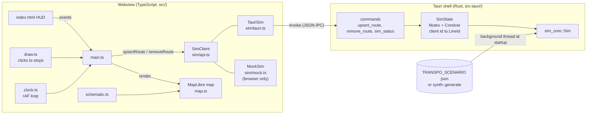

# App architecture

## Shape



The client holds all UI state. The simulation is reached only through the
`SimClient` interface, and the webview never holds simulation state: the shell
owns the `Sim` and the mapping from client route ids to sim-core `LineId`s.
Rendering is a pure function of `routes`, `results` and the current zoom.
Every change calls `render()`, which rebuilds the GeoJSON for the line and stop
sources. With M1-sized networks (tens of lines) that costs well under a
millisecond, so there is no diffing or caching.

## Modules

| File | Responsibility | Depends on |
|---|---|---|
| `src/sim/api.ts` | The contract: `Mode`, `Stop`, `RouteSpec`, `RouteResult`, `SimClient`, `isRegional()` | nothing |
| `src/sim/index.ts` | `createSim()`: `TauriSim` inside Tauri, `MockSim` in a browser | api, tauri, mock |
| `src/sim/tauri.ts` | `TauriSim`, plus `toTransitLine()` / `fromLineResult()` conversions | api, `@tauri-apps/api` |
| `src/sim/mock.ts` | `MockSim` and the stand-in model ([MOCK-SIM.md](MOCK-SIM.md)) | api |
| `src/map.ts` | Creates the MapLibre map, loads the basemap (with offline fallback), adds every source and layer, defines zoom bands | maplibre-gl, data/geo |
| `src/schematic.ts` | Octilinear layout of regional lines, interchange merging, morph helper ([SCHEMATIC.md](SCHEMATIC.md)) | api, mock.km |
| `src/draw.ts` | Drawing state machine: click adds a stop, Enter/double-click finishes, Esc cancels, snaps to existing stops | map |
| `src/clock.ts` | `GameClock`: game minutes, pause, time-lapse steps | nothing |
| `src/main.ts` | Wires everything: route list, sim round trips, render, HUD events, keyboard, clock loop | all of the above |
| `src-tauri/src/main.rs` | Tauri builder: manages `SimState`, registers commands | sim |
| `src-tauri/src/sim.rs` | `SimState` (build on a background thread, wait, map ids), the three commands, Rust tests | sim-core, tauri |

## How the map and the sim talk

1. The player finishes a line in `draw.ts`, which calls back into
   `main.addRoute(mode, points)`.
2. `addRoute` builds a `RouteSpec` (ids, default headway of 15 min for local
   modes and 30 min for regional ones, fare $1.25, a color) and calls
   `sim.upsertRoute(route)`.
3. `TauriSim` converts it to a sim-core `TransitLine` and calls
   `invoke("upsert_route", { routeId, line })`.
4. In the shell, `SimState::upsert` waits until the `Sim` is built, then
   calls `update_line` if the client id is known and `add_line` (recording the
   new `LineId`) if not. It returns `sim.results().lines` for **every** line,
   each tagged with its client `route_id`. sim-core refreshes results for all
   lines on every edit, because lines compete for riders.
5. `TauriSim` maps `boardings_by_stop` (stop order) back to the client's stop
   ids and returns `RouteResult[]`.
6. `apply()` in `main.ts` stores the results, shows the backend label and
   round-trip time in the panel header (or the error message if the call
   rejected), and calls `render()` and `renderPanel()`.
7. `render()` puts per-stop boardings into the `stops` source. The stop circle
   radius and labels read them (the `boardings` property) at City zoom and
   closer.

A line edit in sim-core takes about 20 to 30 ms on the synthetic Travis region
(measured 31 ms in a release build), well inside the M1 target of 2 s. The
first edit also waits for the startup build.

### Why async commands and a Condvar

`Sim::new` runs the baseline to equilibrium and takes seconds, so it runs on a
background thread started in `SimState::start()`, and the window opens
immediately. Commands are `async fn`, so Tauri runs them on its async runtime
instead of the main thread. A command that arrives early blocks its worker
on the `Condvar` until the build finishes or fails. A failed build stores the
error, and every later command returns it instead of hanging. This is tested in
`load_failure_is_reported_not_hung`.

### The contract (`sim/api.ts`)

```ts
interface SimClient {
  readonly label: string;
  upsertRoute(route: RouteSpec): Promise<RouteResult[]>; // add or replace, re-run, all results
  removeRoute(id: string): Promise<RouteResult[]>;
}
interface RouteSpec { id; name; mode: Mode; color; stops: Stop[]; headwayMin; fare }
interface RouteResult { routeId; dailyRiders; boardingsByStop: Record<stopId, number>;
                        operatingCostPerDay?; fareboxRecovery? }
```

`Mode` mirrors the mode list of sim-core's `TransitLine` in
[`crates/sim-core/src/schema.rs`](../../crates/sim-core/src/schema.rs) exactly
(no hyperloop), so a `RouteSpec` maps onto a `TransitLine` field by field
(`toTransitLine` in `sim/tauri.ts`):

| App `RouteSpec` | sim-core `TransitLine` |
|---|---|
| `name` | `name` |
| `mode` | `mode` (same strings) |
| `stops[].lngLat` | `stops[].lon`, `stops[].lat` |
| `stops[].name` | `stops[].name` |
| (derived) | `stops[].park_ride` = `isRegional(mode)` |
| `headwayMin` | `headway_min` |
| `fare` | `fare` |
| `id` | kept in the shell's `route_id` to `LineId` map |
| `color` | app-only |

And back (`fromLineResult`): `daily_boardings` becomes `dailyRiders`,
`boardings_by_stop[i]` becomes `boardingsByStop[stops[i].id]`, and
`operating_cost_per_day` and `farebox_recovery` pass through. The other
`LineResult` fields (segment loads, peak load against capacity, vehicles
required) already cross the IPC boundary and are ignored until the UI renders
them.

### Clock ownership

The clock still lives in the client (decision A9). sim-core's `Sim::tick`
advances its own `Clock` and re-equilibrates once per game day crossed, which
takes seconds. Wiring it means a worker loop in the shell, plus events back to
the client when results change. That is F21's move into sim-core. The UI
contract (pause, time-lapse button, zoom-independent speed) will not change.
Until then, line edits refresh results directly, and car congestion is as
computed at startup (`results().car_times_stale` turns true after an edit).

## Map layers (`map.ts`)

Drawn bottom to top over the basemap:

| Layer | Source | Purpose |
|---|---|---|
| `wash` | world polygon | White overlay fading in below z11.5 so the schematic reads cleanly over the basemap ("roads fade to a thin layer underneath") |
| `outlines` | Texas + Travis County outlines | Orientation, and the only geography when the basemap is offline |
| `bus-lines` | `bus-lines` | Local modes (bus, trolleybus, BRT), `minzoom` 11 |
| `rail-lines` | `rail-lines` | Regional modes, coordinates morphed between schematic and geography |
| `stops` | `stops` | White dots; interchange stations get a black ring; radius grows with boardings at City zoom |
| `stop-labels` | `stops` | `Name · boardings`; regional stops from z8, local stops from z13 |
| `draft-line`, `draft-stops` | `draft` | The line being drawn |

Zoom bands follow the design doc's table (view width to zone unit):
State below z7.5, Region to z10.5, City to z13.5, Neighborhood above.
Schematic is full at z10 and below, geography full at z11.5 and above, and
the morph runs in between.

### Basemap

Default style: OpenFreeMap "liberty" (free, keyless, OSM-based). Override with
`VITE_MAP_STYLE=<style url>` in `app/.env.local`. The style is fetched with a
4-second timeout; on failure the app uses a plain background style plus the
built-in outlines, so the game still runs offline and in sandboxed CI. Labels
need the glyph server; offline they silently don't render.

OSM data is ODbL: MapLibre's attribution control is on (compact) and must stay.

## The clock (`clock.ts`)

`GameClock.minutes` counts game minutes since Day 1 00:00 (starts at 06:00).
`main.ts` runs a `requestAnimationFrame` loop that calls
`tick(realSecondsSinceLastFrame)`. `tick` adds `realSeconds * speed` unless
paused. Speed comes only from the time-lapse steps `[1, 2, 10, 60]`. Nothing
in the zoom path touches the clock: `map.on("zoom")` only calls `render()`.
This is the "zoom never changes the timescale" rule, and the unit test
`clock > runs 1 game minute per real second...` pins the arithmetic.

Skip-to-next-month and monthly budget settlement are M2 work.

## Desktop shell (`src-tauri/`)

See "How the map and the sim talk" above for the simulation commands. Dev
builds compile `sim-core` and `rayon-core` at `opt-level = 3`
(`[profile.dev.package.*]` in `src-tauri/Cargo.toml`), because an
unoptimized sim-core took 16 s to build the Travis scenario at startup.

Minimal Tauri 2 app: one window (1400x900, min 900x600) loading the Vite dev
server in dev (`devUrl`, port 1420) and `../dist` in builds. `csp` is null
for now because the basemap pulls tiles and fonts from a third-party host;
tighten it when tiles are bundled locally. Capabilities grant only
`core:default`. Icons were generated with `npx tauri icon` from a placeholder
(red circle with a white T); replace `icons/` by re-running that command on
real art.

## Testing

- `npm test` runs [test/core.test.ts](../test/core.test.ts): clock arithmetic,
  schematic invariants (octilinear elbows, one schematic point per stop,
  interchange merging), and mock-sim sanity (Red Line ridership in a plausible
  band, ridership rising with frequency), and the Tauri adapter conversions.
- `cd src-tauri && cargo test` runs the command-layer tests in `src/sim.rs`
  against `synth::SynthConfig::small()`: add, update in place, remove, and a
  failed scenario load returning an error.
- Manual / e2e: `npm run dev`, then exercise the loop. In dev builds the map is
  exposed as `window.__map` so scripts (Playwright) can set zoom directly.
