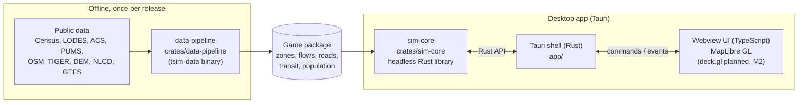

# Architecture

How Transpo-Sim is put together: the components, the data that moves between them, and the rules every component must keep. The design rationale lives in the [design doc](https://claude.ai/artifact/Hjw86789MWbzev8BMVZBz8); this page is the engineering view of it, plus what has been built so far. Decisions are logged in [DECISIONS.md](DECISIONS.md).

Last updated 2026-11-27.

## One-paragraph summary

A Rust data pipeline turns public data (Census, LODES, OpenStreetMap) into a game package once per release. A headless Rust library, `sim-core`, loads that package and runs the travel model: aggregate zone-to-zone flows for the whole state, with individual agents only near the camera. A Tauri desktop app links `sim-core` as native code, talks to it through a message interface, and draws the map in its webview with MapLibre GL (deck.gl planned for the local tier in M2, see [app decision 2](../app/docs/DECISIONS.md)). There is no server.

As built today (2026-11-27): the pipeline writes `scenario.json` for Travis County; sim-core has the input schema, the travel model and the `Sim` API (#7); the desktop app links sim-core through Tauri commands (the browser-only `npm run dev` still uses a TypeScript mock behind the same client interface).

## Components



| Component | Path | Language | Responsibility | Docs |
|---|---|---|---|---|
| Cargo workspace | `Cargo.toml` | Rust | Builds every crate under `crates/*` together | this page |
| data-pipeline | `crates/data-pipeline` | Rust | Download, clip and join public data; write the game package | [README](../crates/data-pipeline/README.md) |
| sim-core | `crates/sim-core` | Rust | Demand model, mode choice, assignment, clock, economy; owns the input schema | [README](../crates/sim-core/README.md) |
| app | `app/` | Rust (Tauri) + TypeScript | Desktop shell, map rendering, player tools; no simulation logic. `app/src-tauri` is its own Cargo workspace, outside `crates/*` | [README](../app/README.md), [app docs](../app/docs/ARCHITECTURE.md) |

### Dependency direction

`app` depends on `sim-core` as a path dependency from `app/src-tauri/Cargo.toml`. `data-pipeline` depends on `sim-core` only for the input schema types. `sim-core` depends on neither. Keep it that way: the design doc requires the core to stay a headless library so a future client swap does not touch it, and keeps the zone hierarchy and population decoupled from transport code so the city-builder path stays open.

## Data flow

1. **Build time.** `tsim-data` reads raw files from `crates/data-pipeline/data/raw` (fetched by `scripts/fetch.sh`, gitignored) and writes the package to `--out`. Travis County (`48453`) for M0/M1; all of Texas (`--area 48`) from M3. The manual **data-pipeline** workflow publishes each build as GitHub Release `data-<area>-<year>`; `crates/data-pipeline/scripts/download-build.sh` fetches it and prints the `TRANSPO_SCENARIO` path the app loads.
2. **Load.** `sim-core` deserializes the package into `ScenarioInput` and runs `validate()`.
3. **Run.** `sim-core` computes skims, demand, mode split and assignment. A player edit (add or change a line) triggers incremental re-evaluation, target under 2 s per metro.
4. **Display.** The app requests results through the message interface and renders layers: desire lines, link volumes, line ridership, agents near the camera, and the tube schematic at State and Region zoom.

## Simulation tiers

Three tiers run on one clock. Only the camera's neighborhood ever becomes individual agents.

| Tier | Scope | Zone unit | Method | Update rate | Milestone |
|---|---|---|---|---|---|
| Strategic | All of Texas, always | Tract (~6,900) | OD matrices, logit mode split, static assignment on contracted highway graph | Once per game day, incremental | M3 |
| Regional | Metros built in or viewed | Block group | Mesoscopic queues, spillback, per-trip transit loads | Every 5–15 game min | M1 (Travis), M3 (all metros) |
| Local | ~5 km around camera | Block, then people | Agents sampled from regional flows | Real time | M2 |

### Invariants (enforce in code and tests)

- **Flows go down, corrections go up.** Local agents are sampled from regional flows; regional flows are disaggregated from strategic OD; measured travel times feed back up as link-cost corrections.
- **The camera never changes the score.** Budget, ridership and approval are computed from the strategic and regional tiers only.
- **Determinism.** Sampling is seeded per zone and time slice. Same seed, same people on the same bus after zooming out and back in. Saves hold aggregate state plus seeds, never agents.
- **One clock.** Zoom changes which tiers are drawn, never how fast time runs. Time-lapse speeds every tier together. Above 10x the local tier draws flow animation instead of agents.

## Interfaces

### Pipeline to sim-core: `ScenarioInput`

Owned by sim-core. Source of truth: [`crates/sim-core/src/schema.rs`](../crates/sim-core/src/schema.rs), documented in the [sim-core README](../crates/sim-core/README.md#input-schema-contract-with-data-pipeline). One JSON file per region: `zones`, `road_nodes`, `road_links`, `commutes`, optional `lines`. Coordinates WGS84 degrees, money 2024 USD, ids `u32`. A change to this schema is a breaking change for the pipeline and needs both READMEs updated in the same PR.

### sim-core to app: `Sim` API and Tauri messages

sim-core's side exists (#7, [sim-core README](../crates/sim-core/README.md#public-api-sim)): `Sim::new` / `from_json` build from a scenario; `add_line` returns a stable `LineId`, and `add_line` / `update_line` / `remove_line` each refresh `results()` for every line in 20 to 80 ms. New lines and new alignments are built first (`opening_day`, `pending_lines`; light rail about 6 game months at 12x) unless `params.instant_build` is set (default false, SIM-4). `preview_line` returns a line's capital cost, federal grant and ridership without building it (the build preview), and `ledger()` holds cash, monthly statements, bonds and the bankruptcy state; `add_line`/`update_line` charge capital and `issue_bond` borrows. Each `LineResult` carries `daily_boardings` and `boardings_by_stop` aligned with the line's stops. `tick(real_dt)` advances the shared `Clock` and runs a warm-started re-equilibrium at game-day boundaries (about 2 s at Travis size; run it off the UI thread). Results are `serde::Serialize`; `Sim` is `Send`, so the app holds it in a `Mutex`.

The app's side: [`app/src-tauri/src/sim.rs`](../app/src-tauri/src/sim.rs) holds the `Sim` in Tauri state, built at startup on a background thread from `TRANSPO_SCENARIO`, else the downloaded Travis build (`npm run data`, APP-2), else `synth::generate`. Its commands include `upsert_route(routeId, line: TransitLine)`, `remove_route(routeId)`, `preview_route`, `ledger`, `clock`/`set_clock`/`skip_to_next_month` and `sim_status` (full list in the [app README](../app/README.md#tauri-commands-src-taurisrcsimrs)). The first two return `LineResult` for every line, tagged with the client's route id, and the shell keeps the map from client ids to `LineId`. In the webview, [`app/src/sim/api.ts`](../app/src/sim/api.ts) defines `SimClient`, which `TauriSim` ([`app/src/sim/tauri.ts`](../app/src/sim/tauri.ts)) implements over those commands. `createSim()` falls back to `MockSim` only outside Tauri. Details are in [app ARCHITECTURE, "How the map and the sim talk"](../app/docs/ARCHITECTURE.md#how-the-map-and-the-sim-talk). The webview never holds simulation state. sim-core owns the game clock: a shell worker calls `Sim::tick` every 100 ms and the client polls it (F21, APP-1).

### Pipeline output files

The pipeline writes `scenario.json` as `sim_core::ScenarioInput` directly (it depends on sim-core and calls `validate()` before writing), plus detail files sim-core does not need, keyed by the same ids: `zones.json` (GEOID, worker and commute counts), `roads.json` (OSM class, name, drawing shape, **total** lanes), `transit.json` (existing OSM routes, with GTFS weekday headways where matched, DATA-6), `existing_lines.json` (today's CapMetro network as sim-core `TransitLine`s, for calibration and the keep-existing-transit toggle; copied into `scenario.json` `lines` only with `--existing-lines`, DATA-7) and `manifest.json` (summary, top 20 flows). Full spec: [data-pipeline OUTPUT_FORMAT.md](../crates/data-pipeline/docs/OUTPUT_FORMAT.md).

Traps for consumers:

- `road_links[].lanes` in `scenario.json` is **per direction** (two-way OSM total halved, minimum 1). `roads.json` `edges[].lanes` is the **total**. Do not mix them.
- Zone and road-node ids equal array positions in the detail files, but are not stable across areas or OSM snapshots. Use GEOID or OSM id for anything that must survive a rebuild.
- `zero_car_share`, `median_income`, `parking_cost`, `area_km2` are written as sim-core defaults until ACS and TIGER inputs are added (roadmap F31).
- OSM transit `mode` values (`train`, `subway`, ...) are not sim-core `Mode` values; mapping (for example `train` to `commuter_rail` for the Red Line) is the consumer's job (F19, F44). `existing_lines.json` has already done it for CapMetro.

## Repository layout

```
Cargo.toml              Rust workspace root (members = crates/*)
crates/
  sim-core/             simulation library, input schema
  data-pipeline/        tsim-data binary, public data -> game package
app/                    Tauri desktop app: TypeScript client (src/), Rust shell (src-tauri/, own workspace)
docs/                   this hub: roadmap, architecture, decisions, docs standard
.github/workflows/      CI, see below
```

## Continuous integration

| Workflow | Runs on PRs touching | What it runs |
|---|---|---|
| [data-pipeline.yml](../.github/workflows/data-pipeline.yml) | `crates/data-pipeline/**` | `cargo test` and `clippy -D warnings` for data-pipeline; manual dispatch builds a real package from Census and OSM downloads |
| [rust.yml](../.github/workflows/rust.yml) | `crates/**`, `Cargo.toml`, `Cargo.lock` (also pushes to main) | Whole root workspace with warnings as errors: `cargo fmt --check`, `build`, `test`, `clippy -D warnings`, `doc`; then the sim-core bench, which fails if a line edit takes 2 s or more (F18) |
| [app.yml](../.github/workflows/app.yml) | `app/**`, `crates/sim-core/**` | `npm ci`, `npm run build`, `npm test`; `cargo test` and `clippy -D warnings` in `app/src-tauri` |

## As-built deviations from the design doc

| Design doc says | Built | Notes |
|---|---|---|
| Data pipeline in Python (osmnx, geopandas, pandas) | Rust crate `data-pipeline` | One toolchain, compile-time schema check, statewide PBF speed, few dependencies. See [pipeline architecture](../crates/data-pipeline/docs/ARCHITECTURE.md) and D14 |
| Census tract and block-group polygons from TIGER | Block-group population-weighted centroids only | Polygons deferred until the map needs zone fills |

## Open engineering questions

- **Package format.** JSON is interim. A binary format and tile streaming land with M3 (F33).
- **OSM ODbL.** The derived road database ships with the game; it needs attribution and share-alike review before any sale (F46).
