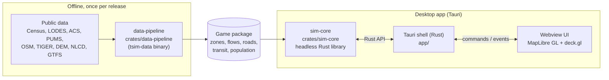

# Architecture

How Transpo-Sim is put together: the components, the data that moves between them, and the rules every component must keep. The design rationale lives in the [design doc](https://claude.ai/artifact/Hjw86789MWbzev8BMVZBz8); this page is the engineering view of it, plus what has been built so far. Decisions are logged in [DECISIONS.md](DECISIONS.md).

Last updated 2026-11-27.

## One-paragraph summary

A Rust data pipeline turns public data (Census, LODES, OpenStreetMap) into a game package once per release. A headless Rust library, `sim-core`, loads that package and runs the travel model: aggregate zone-to-zone flows for the whole state, with individual agents only near the camera. A Tauri desktop app links `sim-core` as native code, talks to it through a message interface, and draws the map in its webview with MapLibre GL and deck.gl. There is no server.

## Components



| Component | Path | Language | Responsibility | Docs |
|---|---|---|---|---|
| Cargo workspace | `Cargo.toml` | Rust | Builds every crate under `crates/*` together | this page |
| data-pipeline | `crates/data-pipeline` | Rust | Download, clip and join public data; write the game package | [README](../crates/data-pipeline/README.md) |
| sim-core | `crates/sim-core` | Rust | Demand model, mode choice, assignment, clock, economy; owns the input schema | [README](../crates/sim-core/README.md) |
| app | `app/` | Rust (Tauri) + TypeScript | Desktop shell, map rendering, player tools; no simulation logic | [README](../app/README.md) |

Links to component READMEs resolve once each component's first PR merges.

### Dependency direction

`app` depends on `sim-core`. `data-pipeline` depends on `sim-core` only for the input schema types (target state, see [interface gaps](#known-interface-gaps)). `sim-core` depends on neither. Keep it that way: the design doc requires the core to stay a headless library so a future client swap does not touch it, and keeps the zone hierarchy and population decoupled from transport code so the city-builder path stays open.

## Data flow

1. **Build time.** `tsim-data` reads raw files from `crates/data-pipeline/data/raw` (fetched by `scripts/fetch.sh`, gitignored) and writes the package to `--out`. Travis County (`48453`) for M0/M1; all of Texas (`--area 48`) from M3.
2. **Load.** `sim-core` deserializes the package into `ScenarioInput` and runs `validate()`.
3. **Run.** `sim-core` computes skims, demand, mode split and assignment. A player edit (add or change a line) triggers incremental re-evaluation, target under 2 s per metro.
4. **Display.** The app requests results through the message interface and renders layers: desire lines, link volumes, line ridership, agents near the camera, and the tube schematic at State and Region zoom.

## Simulation tiers

Three tiers run on one clock. Only the camera's neighborhood ever becomes individual agents.

| Tier | Scope | Zone unit | Method | Update rate | Milestone |
|---|---|---|---|---|---|
| Strategic | All of Texas, always | Tract (~6,900) | OD matrices, logit mode split, static assignment on contracted highway graph | Once per game day, incremental | M3 |
| Regional | Metros built in or viewed | Block group | Mesoscopic queues, spillback, per-trip transit loads | Every 5–15 game min | M1 (Travis), M3 (all metros) |
| Local | ~5 km around camera | Block, then people | Agents sampled from regional flows | Real time | M2 |

### Invariants (enforce in code and tests)

- **Flows go down, corrections go up.** Local agents are sampled from regional flows; regional flows are disaggregated from strategic OD; measured travel times feed back up as link-cost corrections.
- **The camera never changes the score.** Budget, ridership and approval are computed from the strategic and regional tiers only.
- **Determinism.** Sampling is seeded per zone and time slice. Same seed, same people on the same bus after zooming out and back in. Saves hold aggregate state plus seeds, never agents.
- **One clock.** Zoom changes which tiers are drawn, never how fast time runs. Time-lapse speeds every tier together. Above 10x the local tier draws flow animation instead of agents.

## Interfaces

### Pipeline to sim-core: `ScenarioInput`

Owned by sim-core. Source of truth: [`crates/sim-core/src/schema.rs`](../crates/sim-core/src/schema.rs), documented in the [sim-core README](../crates/sim-core/README.md#input-schema-contract-with-data-pipeline). One JSON file per region: `zones`, `road_nodes`, `road_links`, `commutes`, optional `lines`. Coordinates WGS84 degrees, money 2024 USD, ids `u32`. A change to this schema is a breaking change for the pipeline and needs both READMEs updated in the same PR.

### sim-core to app: `Sim` API and Tauri messages

Not built yet (roadmap F15). Planned surface from the sim-core README: build a `Sim` from a scenario, add/update/remove lines with sub-2-second re-evaluation, read results, advance the shared clock. The app calls it only through Tauri commands and receives results as events; the webview never holds simulation state.

### Known interface gaps

As of 2026-11-27 the data-pipeline branch writes an interim format (`zones.json`, `flows.json`, `roads.json`, `transit.json`, `manifest.json`, types in `crates/data-pipeline/src/model.rs`) that does not yet match `ScenarioInput`. Roadmap F03 closes this. Differences to resolve:

| Field | Pipeline (interim) | sim-core `ScenarioInput` |
|---|---|---|
| Zone key | `geoid` string; references use position index | `id: u32` |
| Zone to road link | none | `road_node` (nearest drivable node) required |
| Road nodes | `nodes: [[lon, lat]]`, index = id | `road_nodes: [{id, lon, lat}]` |
| Lanes | total, both directions unless oneway | per direction |
| Commute flows | `flows` with `home`/`work` as zone indexes | `commutes` with `home`/`work` as zone ids |
| Files | one file per layer | one file per region |
| Extra pipeline fields | `resident_workers`, `commute_out`, `commute_in`, road `class`, `name`, `shape` | not in schema (shape is needed by the app for drawing) |

The lanes semantics difference is the one that silently produces wrong capacities if missed.

## Repository layout

```
Cargo.toml              workspace root (members = crates/*)
crates/
  sim-core/             simulation library, input schema
  data-pipeline/        tsim-data binary, public data -> game package
app/                    Tauri desktop app (shell + webview UI)
docs/                   this hub: roadmap, architecture, decisions, docs standard
.github/workflows/      CI (data-pipeline workflow can build a package in Actions)
```

## As-built deviations from the design doc

| Design doc says | Built | Notes |
|---|---|---|
| Data pipeline in Python (osmnx, geopandas, pandas) | Rust crate `data-pipeline` | Rationale not yet recorded; effect is one toolchain and shared schema types. See D14 in [DECISIONS.md](DECISIONS.md) |
| Census tract and block-group polygons from TIGER | Block-group population-weighted centroids only | Polygons deferred until the map needs zone fills |

## Open engineering questions

- **Crate licences disagree.** The workspace sets `license = "UNLICENSED"`; `data-pipeline` declares `MIT OR Apache-2.0`. Pick one before anything ships.
- **Package format.** JSON is interim. A binary format and tile streaming land with M3 (F33).
- **OSM ODbL.** The derived road database ships with the game; it needs attribution and share-alike review before any sale (F46).
