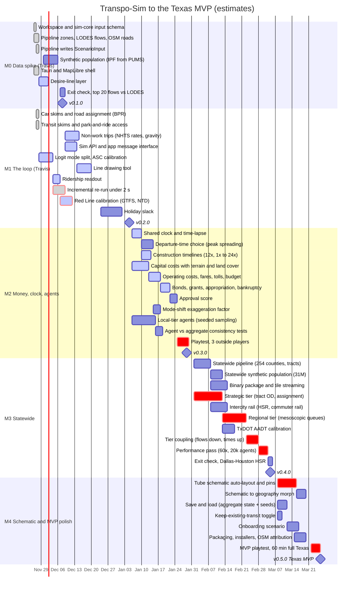

# Roadmap to the Texas MVP

Every feature planned through the Texas MVP, grouped by milestone, with dependencies, exit criteria and estimated dates. Scope comes from the approved [design doc](https://claude.ai/artifact/Hjw86789MWbzev8BMVZBz8) ("MVP scope and milestones" plus the systems sections it references). Nothing here adds scope; where the design doc leaves a feature unassigned, the table says which milestone this roadmap put it in and why.

**All dates are estimates.** See [Schedule assumptions](#schedule-assumptions). Last updated 2026-11-27.

## Release milestones

| Release | Milestone | Est. date | Proves |
|---|---|---|---|
| v0.1.0 | M0, data spike on Travis County | 2026-12-08 | Public data becomes a correct demand picture on a map |
| v0.2.0 | M1, the loop on Travis County | 2027-01-05 | Drawing a line changes ridership fast and believably |
| v0.3.0 | M2, money, clock and agents | 2027-01-29 | The loop is a game people want to keep playing |
| v0.4.0 | M3, statewide | 2027-03-05 | The model holds for 31M people at 60x time-lapse |
| **v0.5.0** | **M4, schematic and polish = Texas MVP** | **2027-03-26** | 60 minutes on the full Texas map is fun |

Realistic window for the MVP: 2027-03-26 to late April 2027. M3 carries the most risk (see [Risks to the schedule](#risks-to-the-schedule)).

Release numbering: each milestone exit is tagged `vX.Y.0` on `main`. 1.0 is reserved for the post-MVP mode set, matching the design doc's "1.0" phase column.

## Gantt

Features marked "Prototype (#2)" or "Partial (#2)" in the tables already have an early version in `app/`: extend it, do not rebuild it.

Red bars (`crit`) are the gates most likely to move the MVP date: exit tests that need calibration or outside players, and the statewide performance chain.

## Features by milestone

Areas map to the three build streams: **pipeline** = `crates/data-pipeline`, **core** = `crates/sim-core`, **app** = `app/` (Tauri shell and map). Status is as of the "last updated" date above.

### M0, data spike on Travis County (v0.1.0)

Goal: one county of real public data, turned into zones, flows and a road graph, drawn as desire lines in the app.

| ID | Feature | Area | Depends on | Done when | Status |
|---|---|---|---|---|---|
| F01 | Cargo workspace and sim-core input schema (`ScenarioInput`, `validate()`) | core | none | Schema compiles, `tiny.json` fixture validates | Done (#1) |
| F02 | Pipeline: block-group zones, LODES OD flows, OSM drivable road graph, OSM transit relations | pipeline | none | `cargo run --release` writes zones, roads, transit and manifest for Travis | Done (#3) |
| F03 | Pipeline writes `scenario.json` as `sim_core::ScenarioInput` (lanes per direction, `road_node` per zone, `commutes`) and runs `validate()` | pipeline, core | F01, F02 | Travis output loads in sim-core with zero validation errors. Format: [OUTPUT_FORMAT.md](../crates/data-pipeline/docs/OUTPUT_FORMAT.md) | Done (#3) |
| F04 | Synthetic population: expand ACS PUMS households to ACS block-group totals with IPF; home block, age, income band, car availability, value of time | pipeline | F02 | Block-group marginals (household size, income, vehicles) reproduced within 5% | Planned |
| F05 | Tauri app shell with MapLibre GL base map, sim-core linked as native Rust | app | F01 | App launches on desktop and shows the Travis base map | Done (#2, #9): shell and map (#2); sim-core linked as a path dependency (#9) |
| F06 | Desire-line layer from zone-to-zone flows (MapLibre; deck.gl deferred to M2 per app decision 2) | app | F03, F05 | Flows render, line width scales with workers | Partial (#12): layer renders sim-core `desire_lines` (top 300 pairs); width scales with daily trips (all purposes, not workers only); color shows transit share |
| F07 | M0 exit check | all | F03, F06 | **Top 20 commute flows match LODES totals** (pipeline manifest already lists them) | Planned |

### M1, the loop on Travis County (v0.2.0)

Goal: the core loop. Draw a transit line, see ridership respond in under 2 seconds, and trust the number.

| ID | Feature | Area | Depends on | Done when | Status |
|---|---|---|---|---|---|
| F11 | Car travel times: shortest paths on the road graph, static assignment with BPR congestion | core | F03 | Zone-to-zone car skims computed for Travis; congested times exceed free-flow on I-35 at peak | Built (#7); exit check on real Travis data (I-35 peak) pending; on the real Travis build sim-core loads in 5.8 s and re-runs a day in 1.9 s after dead-end pruning and chain contraction (SIM-2) |
| F12 | Transit skims: walk access and egress, wait (half headway), in-vehicle, transfers; drive-to-transit (park-and-ride) access | core | F03 | Skims exist for every zone pair a line serves; park-and-ride stops offer drive access | Done (#7) |
| F13 | Non-work trips: NHTS rates by purpose (2.28 total trips/person/day, 2022 NHTS, D29), gravity destinations weighted by OSM POIs and LODES jobs by sector | core, pipeline | F04 | Daily trips per person and purpose split match NHTS within 10%. *Placed in M1 because Red Line calibration (F19) counts all riders, not only commuters.* | Partial (#7, #14): single-purpose gravity model on car time; total rate 2.28 trips/person/day from the 2022 NHTS (D29); no purpose split or POI weights |
| F14 | Multinomial logit mode split on generalized cost (wait and walk weighted ~2x in-vehicle); ASCs calibrated per metro to ACS mode share | core | F11, F12, F13 | Baseline reproduces Travis ACS commute mode shares within 2 points | Partial (#7): six-way logit and `calibrate_mode_shares`; not yet calibrated to Travis ACS shares |
| F15 | Sim API (`Sim`: build, add/update/remove lines, read results, advance clock) and Tauri command/event interface | core, app | F01, F05 | App calls sim-core through the message interface only, no direct state access | Partial (#7, #9): sim-core `Sim` API done (#7); Tauri commands `upsert_route`, `remove_route`, `sim_status` wired (#9); clock advance not wired (F21) |
| F16 | Line drawing tool: place stops, pick mode, set headway and fare; preview cost and forecast before commit | app | F15 | A line can be drawn, edited and deleted in the app | Partial (#2, #9, #15, #22): drawing with a capital cost, grant and ridership preview from `Sim::preview_line`; stop editing (move, insert, delete), rename, headway and delete work against sim-core; cash shown from `Sim::ledger()`; no mode/fare pickers |
| F17 | Ridership readout per line and stop | app, core | F14, F16 | Boardings per line and stop shown after each edit | Partial (#2, #9): daily boardings per line and per stop come from sim-core in the desktop app, from the mock in browser-only `npm run dev`; the Red Line preset uses real stations and commuter rail defaults to the $3.50 MetroRail fare (#31); the sim-core replica is 16% above APTA weekday ridership (F19), but mode shares are not yet calibrated (F14) |
| F18 | Incremental re-evaluation after a line edit | core | F14 | **A line edit updates ridership in under 2 seconds** on Travis | Done (#7, #28): `add_line` takes 0.04 s and `preview_line` 0.10 s on the real Travis build (766 zones, 93k road nodes), well under the 2 s target; the `rust.yml` bench (synthetic Travis-sized region) fails CI at 2 s |
| F19 | Calibration harness: CapMetro Red Line replica from GTFS, compared against NTD ridership | core, pipeline | F17 | **Red Line replica forecasts within 30% of reported ridership** | Partial (#30, #34): `examples/redline.rs` runs the Red Line from real OSM stops on the real Travis build at the real 32 min peak and 51 min midday headways (SIM-3): 1,738 boardings/day vs 1,500 average weekday (APTA 2023), 16% high, inside the 30% band before ACS calibration. Not yet a CI check |

MVP transit modes (bus, BRT, tram/light rail, commuter rail, metro, HSR) are entries in one mode table, not separate systems. F12 and F14 must work for all of them from M1; HSR only gets a real test in M3 (F37).

### M2, money, clock and agents (v0.3.0)

Goal: turn the loop into a game. Costs and a budget, one shared clock, people you can watch.

| ID | Feature | Area | Depends on | Done when | Status |
|---|---|---|---|---|---|
| F21 | One game clock for every tier (1 real s ≈ 1 game min); time-lapse 2x, 10x, 60x and skip-to-next-month; zoom never changes speed | core, app | F15 | Clock rate is identical at every zoom; time-lapse applies to all tiers | Partial (#2, #7, #23): sim-core `Clock` driven by a shell worker calling `Sim::tick`; the app polls it, with pause, 1/2/10/60x and skip to next month; ridership refreshes after each daily re-run. Local-tier agents (F28) not yet on it |
| F22 | Desired arrival times and departure-time choice (ACS departure-time distributions, late/early penalties) | core | F14, F21 | Jamming the 8:00 peak shifts some trips earlier (peak spreading visible) | Partial (#7): desired-arrival profile sets the peak-hour share and a transit schedule-delay penalty; no departure-time choice |
| F23 | Capital cost model from the design doc's cost table; terrain (USGS 3DEP DEM) and land cover (NLCD) multipliers; right-of-way priced by block-group density | core, pipeline | F03 | Build preview shows cost; same line costs more through wetlands, water or dense block groups | Partial (#17): per-km guideway plus vehicle fleet from sourced figures (Austin LRT $840M/mi, Eno surface/tunnel, Texas Central HSR, MTC bus and LRV prices); `Sim::preview_line` returns cost, grant and ridership before a line is committed, shown in the app while drawing (#22); no terrain, land cover or right-of-way multipliers |
| F24 | Construction time compressed 12x by default, realism setting 1x to 24x; bond terms and vehicle lifetimes compress by the same factor; capacity degraded on affected roads during construction | core | F21 | A 6-year light rail line builds in 6 game months at default | Partial (#7, #20, #27): lines and realignments build for the mode's real build time / 12 before opening (light rail ~6 game months), old version runs during a rebuild (SIM-1); on by default (`instant_build` false, SIM-4) and in the desktop app, which shows lines under construction (APP-3, #27); no road capacity loss during works, no length scaling |
| F25 | Operating costs (per revenue hour; road maintenance 2–3% of capital/yr), fares (flat, distance, zone), tolls (per-mile, dynamic), monthly budget settlement | core | F23, F21 | Budget settles monthly; fare change moves riders through the logit model | Partial (#7, #14, #17): per-line operating cost from NTD 2023 cost per car hour, CapMetro fares, distance fares, farebox recovery; monthly budget settlement in `Sim::ledger()`, shown as the app's budget line (#22); service changes charge for added vehicles (#20) |
| F26 | Funding: cash, bonds (20–30 yr debt service), federal grants (50–80% match, ridership-per-dollar gate), state appropriation by served population; bankruptcy fail state | core | F25 | Debt service exceeding revenue for 12 months ends the game. *Bankruptcy placed here; elections and loss of mandate are out of the MVP.* | Partial (#17, #20, #35): cash ledger, federal capital grants (50%, capital-per-rider gate), operating assistance, local 1% sales tax over the population within reach of a stop, weighted by stop coverage (D30, #20); level-payment 30-year bonds and the bankruptcy rule, 12 months of debt service above operating surplus or negative cash (SIM-5), per-bond construction grace on the coverage test and a borrowing cap of tax capacity / 2.0 (SIM-6, SIM-7); no state appropriation (Texas gives big-city MTAs none); bankruptcy only blocks new bonds (consequence pending Collins); no bond UI in the app yet. **Open:** SIM-5 uses real 30-year bond terms, while D9 says bond terms compress 12x like build times; awaiting Collins |
| F27 | Approval score from travel-time savings, construction disruption, fare/toll changes, tax burden | core | F26 | Approval responds to each of the four inputs | Planned |
| F2e | Tunable exaggeration factor on mode shifts (design doc risk: believability vs fun) | core | F22 | Factor exposed in settings; default chosen from playtest feedback | Planned |
| F28 | Local tier: agents within ~5 km of the camera sampled from regional flows with seeded RNG per zone and time slice; vehicles follow lanes, riders board and alight; flow animation instead of agents above 10x | core, app | F14, F21 | Zooming out and back in shows the same people on the same bus | Planned |
| F29 | Consistency tests: agents never feed the score; local loads match regional flows | core | F28 | Test suite fails if moving the camera changes budget, ridership or approval | Planned |
| F2p | M2 exit playtest | all | F21–F29 | **Three people who did not build it play 20 minutes unprompted** | Planned |

If the M2 playtest fails, the design doc says the problem is the loop, not the scale: M3 does not start until it passes.

### M3, statewide (v0.4.0)

Goal: all 254 counties at tract level, every metro at block-group level, at 60x time-lapse.

| ID | Feature | Area | Depends on | Done when | Status |
|---|---|---|---|---|---|
| F31 | Statewide pipeline: all 254 counties, tract and county zone levels, TIGER boundaries, ACS tables | pipeline | F02 | `--area 48` builds the full zone hierarchy (county, tract, block group, block) | Planned |
| F32 | Statewide synthetic population (~31M people) | pipeline | F04, F31 | Population matches ACS county totals | Planned |
| F33 | Compact binary game package (target: a few GB) and neighborhood tile streaming in the client | pipeline, app | F31 | App opens Texas without loading all detail into memory | Planned |
| F34 | Strategic tier: tract OD (~6,900 zones), logit split, static assignment on a contracted highway graph, once per game day, incremental | core | F14, F31 | **One game day for all of Texas in under 20 s** | Planned. Groundwork: the pipeline simplifies scenario road graphs for routing (DATA-2, #25) and sim-core contracts degree-2 chains at load (SIM-2, #28). M1 keeps local streets (DATA-3); the statewide highway-only graph is still to build |
| F35 | Regional tier: mesoscopic queues (link flows, capacity, spillback, per-trip transit loads) for metros the player built in or is viewing, every 5–15 game minutes | core | F34 | Runs for every Texas metro at once without dropping below 60x | Planned |
| F36 | Tier coupling: strategic OD disaggregated to regional flows, measured times fed back up as link-cost corrections | core | F35 | Score computed only from strategic and regional tiers; consistency tests (F29) pass statewide | Planned |
| F37 | Intercity rail: HSR (300+ km/h) and commuter rail on dedicated corridors with schedules | core, app | F14, F34 | HSR line can be drawn between metros and gets intercity riders | Planned |
| F38 | Car assignment calibrated against TxDOT AADT counts on major links | core, pipeline | F34 | Major-link volumes within an agreed error band (set during M3) | Planned |
| F39 | Performance pass | core, app | F36 | 60x holds statewide; 20,000 visible agents at 60 fps at 1x | Planned |
| F3x | M3 exit check | all | F37, F39 | **A Dallas–Houston HSR line shifts intercity mode share in a believable direction and size** | Planned |

### M4, schematic and MVP polish (v0.5.0, Texas MVP)

Goal: the readable statewide map, a way in for new players, and a shippable build.

| ID | Feature | Area | Depends on | Done when | Status |
|---|---|---|---|---|---|
| F41 | Tube-style schematic at State and Region zoom: octilinear heuristic layout (0/45/90°), even station spacing, line colors, interchange rings; recomputed on network change; player pins survive re-layout | app, core | F37 | Schematic readable for a 10-line statewide network. Fallback if not: smoothed geographic lines | Prototype (#2): heuristic octilinear layout, no pins. See [SCHEMATIC.md](../app/docs/SCHEMATIC.md) |
| F42 | Morph between schematic and true geography across the Region-to-City zoom band | app | F41 | No line jumps or disappears while zooming | Prototype (#2) |
| F43 | Save and load: aggregate state plus seeds, never agents | core, app | F36 | Load restores identical results and the same agents on screen | Planned |
| F44 | Starting map: real roads present, existing transit removed by default, toggle to keep it (from the pipeline's transit output) | core, app | F02, F43 | New game offers both starts | Planned |
| F45 | Onboarding: a guided first session (read demand, draw a line, see ridership and budget respond). No win condition, per D15 | app, core | F27, F41 | A new player completes it without help | Planned |
| F46 | Packaging: desktop installers, OSM/ODbL attribution screen, data-licence review done | app | F33 | Installer runs on a clean machine; ODbL question answered before any sale | Planned |
| F47 | MVP playtest | all | F41–F46 | **60 minutes of play on the full Texas map** | Planned |

## The MVP is a sandbox

Decided by Collins on 2026-11-27 (D15): the Texas MVP ships as a sandbox. The whole state is open from the start, with **no region unlocks** and **no scenario win conditions**. Both are post-MVP (see below). The fail state that stays in the MVP is bankruptcy (F26).

## After the MVP (unscheduled)

From the design doc's mode table and expansion sections. Not on the Gantt; scheduled after v0.5.0.

| Phase | Features |
|---|---|
| 1.0 modes | Bike, e-bike, scooters; ferry and water taxi; urban gondola; automated people mover and monorail; intercity bus and regional air; maglev (500 km/h); autonomous shuttles and robotaxi fleets |
| 1.0 systems | Elections every 4 game years and loss of mandate (approval below 30%); region unlocks (one metro, then adjacent corridors, gated on approval and revenue); scenario goals with win conditions (e.g. cut I-35 peak travel time 20% by 2035). Unlocks and scenarios are post-MVP per D15 |
| Post-launch | eVTOL air taxis (labelled as projected numbers); freight (needs a goods-demand model) |
| City builder | Passive growth from accessibility logsums; zoning; neighborhood building on real parcels |
| Next state | Open question: which state, free update or paid DLC |

Excluded for good: hyperloop, multiplayer.

## Schedule assumptions

- **Start:** 2026-11-26. Calendar days, weekends included.
- **Pace:** development is agent-driven, with three build streams (pipeline, core, app) running in parallel and one reviewer merging PRs. Writing code is not the bottleneck. The gates are: review and merge throughput, calibration iterations (F14, F19, F38), outside playtesters (F2p, F47), and statewide performance work (F34–F39).
- **Basis:** the design doc's guess for one part-time developer is 16 to 21 weeks. This roadmap estimates about 17 weeks. Parallel agent streams compress M0 and M1; M2 to M4 compress less because their exit tests depend on people and on performance tuning.
- **Holidays:** 2026-12-24 to 2027-01-01 counted as slack inside M1.
- **Re-plan trigger:** a milestone exit slipping more than one week moves every later date; update the Gantt and this table in the same PR.

## Risks to the schedule

| Risk | Hits | Mitigation |
|---|---|---|
| Statewide performance (20 s per day) misses | M3, MVP date | M3 carries the most slack; profile F34 early on Travis-scale replicas |
| Red Line replica misses the 30% band | M1 | Fix the demand model before going statewide (design doc rule); do not start M3 on a failed M1 |
| Playtest says the loop is not fun | M2 | Exaggeration factor (F2e) and clock tuning before M3 |
| Schematic auto-layout unreadable | M4 | Fallback to smoothed geographic lines |
| Pipeline and sim-core schemas diverge | M0 | Closed by F03: the pipeline builds sim-core's types, so drift fails the compile |

## Keeping this current

Whoever merges a feature PR updates its row's Status and, for Gantt bars, the `done`/`active` tag. A milestone exit adds the release tag and the actual date next to the estimate.
